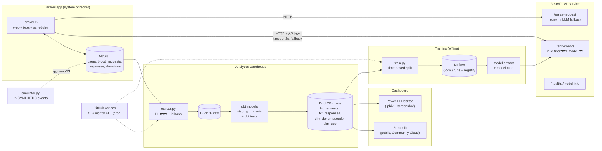

# RoktoDut (রক্তদূত): Data ও AI/ML রূপান্তর পরিকল্পনা

> **তারিখ:** ২০২৬-১১-২৪
> **ভিত্তি:** লোকাল repo (`main` @ `5a2466e`, GitHub-এ `jahidstm/RoktoDut---Blood-Donation-Platform`-এর সাথে একই) সরাসরি পড়ে, test চালিয়ে এবং বাইরের পেজগুলো (GitHub Student Pack, Phitron, বিভিন্ন free-tier পেজ) ২০২৬-১১-২৪ তারিখে খুলে যাচাই করা।
> **সময়ের হিসাব:** দিনে ২–৩ ঘণ্টা, অর্থাৎ সপ্তাহে প্রায় ১৫ ঘণ্টা।
> **আগের সংস্করণ:** ২০২৬-১০-১৭-এর প্ল্যানটা [docs/archive/IMPLEMENTATION_PLAN_2026-10-17.md](docs/archive/IMPLEMENTATION_PLAN_2026-10-17.md)-এ রাখা আছে। সেখানে কিছু দাবি ভুল ছিল (যেমন "`.env` committed")। এই সংস্করণে সবকিছু আবার যাচাই করা হয়েছে।
>
> **চিহ্ন:** ✅ = কোড বা পেজ পড়ে যাচাই করা · ⚠️ = আংশিক বা পরস্পরবিরোধী তথ্য · ❓ = যাচাই করা যায়নি

---

## ১. Repo অডিটের সারসংক্ষেপ

### ১.১ সংক্ষেপে মূল কথা

প্রজেক্টটা feature-এর দিক থেকে বেশ বড়: ৪৩টা model, ৯৫টা migration, ৬টা job, ২০টা notification class এবং একটা FastAPI ML service আছে। কিন্তু **data ও ML-এর ভিত্তি ভাঙা**:

1. **ML-এর label কখনো জমা হয় না।** `donor_response_logs` টেবিলে row তৈরি হয় `status='pending'` দিয়ে ([CheckAndCascadeRequestJob.php:191](app/Jobs/CheckAndCascadeRequestJob.php#L191), [DispatchEmergencyAlertsJob.php:171](app/Jobs/DispatchEmergencyAlertsJob.php#L171))। পুরো codebase-এ এই status কোথাও update হয় না ✅। ফলে production-এ `historical_response_rate` সবসময় 0, এবং মডেলকে আবার train করার মতো real label কখনো তৈরি হবে না। দাতার আসল সাড়া জমা হয় `blood_request_responses` আর `donor_telemetry_logs` টেবিলে।
2. **বর্তমান মডেলটা নিজের বানানো সূত্রই আবার শিখছে।** [bootstrap_data.py](roktodut-ml-service/scripts/bootstrap_data.py) একটা হাতে লেখা probability সূত্র দিয়ে ৮,০০০ row synthetic ডেটা বানায়। LightGBM সেটা শিখে ROC-AUC 0.764 পায় ✅ (`donor_ranker.joblib`-এর metadata থেকে)। এই সংখ্যা শুধু দেখায় যে মডেল ওই সূত্রটা কতটা ফিরিয়ে আনতে পারে। বাস্তব দাতার আচরণ সম্পর্কে এটা কিছুই বলে না। তার ওপর `pending` row-গুলোকে negative label হিসেবে ধরা হয়েছে, যেটা label noise তৈরি করে।
3. **একই কাজের তিনটা আলাদা ranking।** `DonorMatchingService` (ML + distance fallback), `SmartBloodRequestBroadcastJob` (`responseRate*100 − distance*2 − DFI`) এবং `SosBloodRequestBroadcastJob`, প্রতিটায় eligibility query আলাদাভাবে লেখা। সাধারণ blood request-এর মূল flow ([BloodRequestController.php:341](app/Http/Controllers/BloodRequestController.php#L341)) **ML ব্যবহার করে না**। Smart/SOS job-এর নিজস্ব `rank_score` সূত্র দিয়ে ranking হয়ে ৬ ঘণ্টার cache-এ থাকে, আর `CheckAndCascadeRequestJob` ML ডাকে **শুধু cache খালি হলে** (এবং chronic dispatch-এ)। অর্থাৎ বাস্তবে ML প্রায় কখনো চলে না।
4. **Test suite চলে না।** নিচে ১.৬ দেখো।

### ১.২ বর্তমান feature তালিকা (কোড থেকে যাচাই করা ✅)

| এলাকা | কী আছে | প্রমাণ |
|---|---|---|
| Auth | Breeze (email/password), Google OAuth (Socialite), Sanctum, role (`UserRole` enum), email verification বন্ধ | `routes/auth.php`, `SocialAuthController`, `EmailVerificationTest` |
| Donor search ও matching | রক্তের গ্রুপ অনুযায়ী (শুধু exact match), Haversine ≤ 20 km, cooldown, availability calendar (bitmask), DFI (Donor Fatigue Index, Redis) | [DonorMatchingService.php](app/Services/DonorMatchingService.php) |
| Blood request | সাধারণ, guest, SOS, chronic subscription (থ্যালাসেমিয়া/ডায়ালাইসিস), auto-expire (প্রতি ১৫ মিনিটে) | `BloodRequestController`, `EmergencySosController`, `routes/console.php` |
| Donation | claim → recipient confirm → auto-approve, offline claim, certificate, QR token | `DonationClaimController`, `OfflineClaimService`, `CertificateController` |
| Gamification | points, badges, leaderboard, monthly points | `GamificationService` (৮৪৩ লাইন) |
| Org / blood bank | organization, hospital, blood inventory + log, blood camp | সংশ্লিষ্ট model ও controller |
| Privacy/Security | phone mask/reveal rate-limit, NID private disk-এ + retention purge, shadowban, audit log, security radar, math captcha | `PhoneRevealController`, `PurgeExpiredNidData`, `MathCaptchaService` |
| Notification | FCM push, Telegram bot, database notification, Reverb (WebSocket), mail (local-এ `log` driver) | `FcmDispatchService`, `TelegramService` |
| Analytics | district-ভিত্তিক demand heatmap (CRS = 0.6×demand + 0.4×DFI, ওজন হাতে বসানো), admin analytics + CSV export | `SpatialAnalyticsService`, `Admin/AnalyticsController` |
| Chatbot | Gemini (`gemini-2.5-flash`), system prompt-এ user context ও inventory ঢোকানো হয় (RAG নেই) | [ChatbotController.php](app/Http/Controllers/ChatbotController.php) |
| ML service | `/api/v1/rank-donors` (LightGBM), `/api/v1/parse-request` (Groq LLM NER) | [roktodut-ml-service/main.py](roktodut-ml-service/main.py) |
| SMS / WhatsApp | **নেই।** শুধু comment-এ "SMS bankruptcy prevention" লেখা আছে | `SosBloodRequestBroadcastJob.php:36` |

### ১.৩ Laravel structure ও database schema

- **Stack:** Laravel 12, PHP 8.2, Blade + Tailwind + Alpine + Vite, Reverb, Sanctum, Socialite, kreait/laravel-firebase, predis ✅ (`composer.json`)
- **Structure:** `app/Services` (১২টা service), `app/Jobs` (৬টা), `app/Console/Commands` (১৮টা, যার কিছু debug/test-এর জন্য), `app/Enums` (BloodGroup, UrgencyLevel, DonationStatus ইত্যাদি), `routes/web.php` (৫৩৯ লাইন), `routes/api.php` (৪টা route)

**ডেটা ও ML-এর জন্য গুরুত্বপূর্ণ টেবিল:**

| টেবিল | গুরুত্বপূর্ণ কলাম | সম্পর্ক | Data/ML-এ ভূমিকা |
|---|---|---|---|
| `users` | blood_group, gender, date_of_birth, weight, lat/lng, division/district/upazila_id, is_donor, is_available, last_donated_at, last_{whole_blood,plasma,platelet}_donated_at, cooldown_until, dfi_score, total_donations, phone, **nid_number** (encrypted cast নেই, শুধু `$hidden`), nid_path, fcm_token, telegram_chat_id | → district, organization | donor dimension, **উচ্চ PII** |
| `blood_requests` | blood_group, bags_needed/units_needed, component_type, urgency, needed_at, status, district/upazila_id, lat/lng, hospital_id, location_text, ml_confidence_score, guest fields, is_phone_hidden | → requested_by (user, nullable), district, hospital | demand fact |
| `blood_request_responses` | blood_request_id, user_id, status (pending/declined/withdrawn/contacted/accepted…), is_ping_sent, pinged_at, fulfilled_at, fulfilled_by | → request, user | **আসল সাড়ার signal** |
| `donor_response_logs` | request_id, donor_id, notified_at, responded_at, status, distance_km, days_since_last_donation, temporal_hour, is_weekend, historical_response_rate | → request, donor (`cascadeOnDelete`) | ML training table, কিন্তু status কখনো update হয় না |
| `donor_telemetry_logs` | user_id, blood_request_id, notification_type, latency_ms, ignored, distance_km | → user, request | সাড়া দিতে কত সময় লাগল |
| `donations` | donor_id, blood_request_id, donation_date, district (string), claim_status, journey_status, certificate_token | → donor, request | supply fact |
| `health_records` | systolic/diastolic_bp, hemoglobin_level, weight_kg, source=`self_reported` | → user | **স্বাস্থ্য-সংক্রান্ত সংবেদনশীল ডেটা** |
| `blood_request_reports`, `security_radar_events`, `phone_reveal_logs` | report/abuse signal | | anomaly detection-এর সম্ভাব্য label |
| `divisions`/`districts`/`upazilas`, `hospitals` | location hierarchy | | geo dimension |
| `blood_inventories` (+log) | org-ভিত্তিক stock | | supply-এর ছবি |

### ১.৪ ডেটা-ইনভেন্টরি: কী ডেটা আছে, কতটা আছে

| উৎস | অবস্থা |
|---|---|
| `database/database.sqlite` | ✅ ৪৭টা টেবিল, **সব টেবিলে 0 row**। ৭৬টা migration চলেছে, যেখানে repo-তে আছে ৯৫টা, অর্থাৎ এটা পুরোনো |
| লোকাল MySQL (`.env`-এ `DB_CONNECTION=mysql`, DB `roktodut`) | ❓ **যাচাই করা যায়নি।** অডিটের সময় MySQL server চলছিল না (port 3306-এ connection refused)। এতে কত row আছে জানা নেই |
| Production / live deployment | ❓ repo-তে কোনো deployment config নেই, README-ও বলে "production deployment status not specified"। কোনো real user ডেটা আছে কি না যাচাই করা যায়নি; **সম্ভবত নেই** |
| Seeder | ✅ `DatabaseSeeder` → location (৬৪টা জেলা), badge, admin, ৩০+ demo donor, blog। ঐচ্ছিক `EnterpriseSimulationSeeder` → ১০,০০০ synthetic user + health record + donation। **কোনো seeder blood request, response বা response log বানায় না**, তাই চাহিদার কোনো time-series নেই |
| ML synthetic CSV | ✅ ৮,০০০ row, notified_at ২০২৫-০৫-১৮ থেকে ২০২৬-০৫-১৮। status: declined 34.7%, accepted 28.6%, ignored 28.6%, pending 8.1% |
| মডেল artifact | ✅ `donor_ranker.joblib`, trained ২০২৬-০৫-১৮, ROC-AUC 0.764, AP 0.509 (synthetic test split-এ) |

**উপসংহার:** ML train বা evaluate করার মতো real ডেটা নেই। আগের প্ল্যানও এটাই অনুমান করেছিল, কিন্তু MySQL যাচাই না করে নিশ্চিত বলা যাচ্ছে না (নিচে অনুমান #১ দেখো)।

### ১.৫ Authentication, notification, background job, deployment

| বিষয় | অবস্থা |
|---|---|
| Auth | ✅ কাজ করার মতো: Breeze + Google OAuth + Sanctum, role-based policy (`BloodRequestPolicy`, `DonorAvailabilityPolicy`)। Email verification ইচ্ছে করে বন্ধ |
| Notification | ✅ FCM, Telegram, database, Reverb। Mail local-এ `log`। SMS/WhatsApp নেই |
| Background job | ✅ `QUEUE_CONNECTION=database`। Scheduler প্রতি মিনিটে `queue:work --stop-when-empty` চালায় (shared hosting-এর জন্য fallback)। Scheduled কাজ: request expire (১৫ মিনিট), auto-approve (ঘণ্টায়), chronic dispatch (ঘণ্টায়), DFI decay, NID purge, cooldown reminder (সকাল ৮টা, Asia/Dhaka) |
| Deployment | ✅ **নেই।** `.github/`, Dockerfile, docker-compose, Procfile বা অন্য কোনো hosting config নেই। ML service-এর URL hardcoded `127.0.0.1:8001` ([DonorMatchingService.php:19](app/Services/DonorMatchingService.php#L19)), যদিও `config/services.php`-এ `base_url` আছে |

### ১.৬ টেকনিক্যাল ঋণ, নিরাপত্তা ঝুঁকি, ডেটা-কোয়ালিটির সমস্যা

**নিরাপত্তা**

| # | সমস্যা | তীব্রতা | প্রমাণ |
|---|---|---|---|
| S1 | `config/services.php`-এ secret-এর fallback hardcoded: `ROKTODUT_AI_SECRET` (ML API key) এবং `ROKTODUT_INTERNAL_SECRET` (internal NLP endpoint)। Repo public, আর `.env`-এ এই দুটো key সেট করা নেই। তাই চালু অবস্থায় যে কেউ public repo থেকে secret পড়ে `/api/internal/requests/nlp` দিয়ে blood request তৈরি করতে পারবে | 🔴 উচ্চ (deploy করলে) | ✅ `config/services.php:53-54`, `main.py:22` |
| S2 | Firebase **service account private key** commit `288b0f8`-এ আছে। ওই commit শুধু লোকাল branch `backup/prepush-fcm-debug`-এ আছে। GitHub API ওই commit খুঁজে পায় না (422), raw URL 404 দেয়। লোকাল `firebase_credentials.json`-এর `private_key_id` একই, অর্থাৎ key rotate করা হয়নি | 🟠 মাঝারি (এখনো public হয়নি, কিন্তু branch push করলেই হবে) | ✅ |
| S3 | সব pushed branch-এ secret pattern (Google/Groq/OAuth/Telegram/private key) scan করে **কিছু পাওয়া যায়নি** | 🟢 | ✅ |
| S4 | Chatbot user-এর নাম, রক্তের গ্রুপ, জেলা ও মোট donation সংখ্যা Gemini-তে পাঠায়। Gemini-র free tier সম্পর্কে Google-এর pricing পেজে লেখা আছে: free tier-এর content "used to improve our products" | 🟠 privacy | ✅ কোড + pricing পেজ |
| S5 | `nid_number` plaintext। শুধু `$hidden` দিয়ে serialization থেকে লুকানো, কোনো encrypted cast নেই | 🟠 | ✅ `User.php` |
| S6 | FastAPI error response-এ exception text ফেরত যায় (`detail=f"NLP parsing failed: {exc}"`) | 🟡 | ✅ `main.py:223` |
| S7 | Public `/api/analytics/spatial-heatmap` auth ছাড়া চলে। শুধু district-level aggregate দেয়, তাই ঝুঁকি কম, কিন্তু rate limit নেই | 🟢 | ✅ `routes/api.php` |

**Code ও repo**

| # | সমস্যা | প্রমাণ |
|---|---|---|
| T1 | **Test চলে না।** (ক) `bootstrap/cache/config.php` cache করা আছে, তাই `phpunit.xml`-এর SQLite setting উপেক্ষিত হয় এবং test MySQL খোঁজে। (খ) cache বাদ দিয়ে চালালেও দুটো migration-এ MySQL-only `ALTER TABLE ... MODIFY` আছে, যা SQLite-এ ভাঙে: `2026_05_18_165000_expand_blood_requests_for_ai_dispatch.php` আর `2026_05_25_171442_revert_urgency_...`। ফলে প্রায় সব Feature test fail করে | ✅ `php artisan test` চালিয়ে দেখা |
| T2 | Test coverage খুব কম: ১৩টা test file, মোট ৮১৬ লাইন। Matching, eligibility, ML client, analytics-এর কোনো test নেই | ✅ |
| T3 | Root-এ ২০টা scratch file **git-এ tracked**: `test_*.php`, `fix_*.php`, `verify*.php`, `temp_head*.blade.php` (৮০ KB), `restructure_dashboard.{php,py}`, `.FullName`। এছাড়া `roktodut-ml-service/__pycache__/*.pyc` tracked | ✅ `git ls-files` |
| T4 | Eligibility নিয়ম অসামঞ্জস্যপূর্ণ: `User::daysUntilNextDonation()`-এ ৯০ দিন (পুরুষ) / ১২০ দিন (নারী), `DonorMatchingService`-এ সবার জন্য ১২০ দিন, `BloodRequestResponseController`-এর comment বলে "৯০-দিনের রুল" | ✅ |
| T5 | `BloodGroup::compatibleDonors()` (red cell compatibility) আছে, কিন্তু matching-এ ব্যবহার হয় না, সেখানে শুধু exact match। এই টেবিল plasma-র জন্য প্রযোজ্যও নয় (plasma-র compatibility উল্টো দিকে কাজ করে) | ✅ |
| T6 | Request-এ coordinate না থাকলে মডেলে `distance_km = 9999` পাঠানো হয়। Training ডেটায় distance ছিল 0.2–35 km, তাই এটা out-of-distribution input | ✅ `DonorMatchingService.php:94` |
| T7 | `historical_response_rate` সব সময়ের log থেকে হিসাব হয়, notification-এর মুহূর্তের হিসাবে নয়। Train করলে এতে leakage হবে। নতুন দাতার rate 0 ধরা হয়, যাতে নতুনরা চাপা পড়ে (cold-start bias) | ✅ |
| T8 | Groq model `llama3-8b-8192` hardcoded default। Groq-এর deprecations পেজ অনুযায়ী এটা ২০২৫-০৮-৩০ তারিখে **shut down** হয়েছে। ওই পেজ অনুযায়ী এর replacement `llama-3.1-8b-instant`-ও ২০২৬-০৮-১৬-এ shutdown, যদিও models পেজ এখনো একে "production" বলে দেখায় ⚠️। `.env`-এ `GROQ_API_KEY` নেই, তাই parse endpoint local-এ 503 দেয় | ✅ কোড, ⚠️ Groq docs পরস্পরবিরোধী |
| T9 | `main.py` `python-dotenv` import করে, কিন্তু সেটা `requirements.txt`-এ নেই। Laravel পড়ে `ROKTODUT_AI_SECRET`, FastAPI পড়ে `ROKTODUT_API_KEY`। নাম আলাদা, দুটোরই default একই বলে কেবল কাকতালীয়ভাবে কাজ করে | ✅ |
| T10 | Analytics query-তে MySQL-only `DATE_FORMAT` আছে, আর হিসাব সরাসরি OLTP DB-তে চলে। Warehouse নেই | ✅ |
| T11 | `.env.example`-এর শেষ লাইন UTF-16 encoded (`TELEGRAM_ADMIN_CHAT_ID`) | ✅ |
| T12 | `donor_response_logs`-এ `cascadeOnDelete`। কোনো user delete হলে তার ঐতিহাসিক training row-ও মুছে যায় | ✅ |

**ডেটা-কোয়ালিটি**

- `donations.district` একটা free string, অথচ অন্য সব জায়গায় `district_id` FK। Join করলে mismatch হবে।
- `bags_needed` আর `units_needed` দুটো কলাম একই অর্থে।
- `last_donated_at` আর `last_donation_date` দুটো কলাম, সাথে component অনুযায়ী তিনটা আলাদা কলাম। কোনটা আসল উৎস তা অস্পষ্ট।
- `blood_request_responses.status`-এর মানগুলো (`pending` মানে "দিতে চাই", `contacted`, `declined`, `withdrawn`) কোনো enum-এ নেই।
- Urgency-র মান কয়েকবার migration দিয়ে বদলেছে (normalize → revert)।
- Health record সব `self_reported`, কোনো যাচাই নেই।

---

## ২. Feature ম্যাট্রিক্স

**মাপকাঠি:** ক্যারিয়ার-মূল্য ও প্রজেক্ট-মূল্য ১–৫ স্কেলে; কঠিনতা S/M/L; ডেটা-প্রস্তুতি: 🟢 আছে, 🟡 simulator দিয়ে বানাতে হবে, 🔴 real ডেটা ছাড়া অর্থহীন।
Phitron-এর সিলেবাস ২০২৬-১১-২৪-এ phitron.io-র AI/ML কোর্স পেজের JS bundle থেকে পড়া (পেজটা JS-rendered, তাই সাধারণ fetch-এ খালি আসে)। **কোর্সে যা নেই:** SQL, time-series, clustering বা unsupervised learning, gradient boosting (LightGBM/XGBoost), data warehouse/ETL tool, MLflow ধরনের experiment tracking। এগুলো নিজে শিখতে হবে।

| # | Feature | ML কি লাগবে? | ক্যারিয়ার | প্রজেক্ট | কঠিনতা | ডেটা | ফ্রি টুল | Phitron মিল |
|---|---|---|---|---|---|---|---|---|
| F1 | **Response-event logging ঠিক করা** + data dictionary | না (data engineering) | 4 (DE) | 5 | S | 🟢 | Laravel, MySQL | কোর্সে নেই (SQL) |
| F2 | **ELT pipeline:** MySQL → DuckDB, dbt দিয়ে model | না | 5 (DE/DA) | 4 | M | 🟡 | Python, DuckDB, dbt-core + dbt-duckdb, GitHub Actions | "Data Engineering Toolbox" (NumPy/Pandas), dbt/SQL কোর্সে নেই |
| F3 | **Data quality check ও monitoring** | না | 4 | 4 | S | 🟡 | dbt tests (unique/not_null/accepted_values/relationships), pandas assertion | "Feature Engineering" (missing value, outlier detection) |
| F4 | **Smart donor ranking v1 (নিয়মভিত্তিক)**: compatibility + eligibility + দূরত্ব + availability + smoothed response rate | **শুরুতে না।** Eligibility আর compatibility সবসময় hard rule থাকবে, কখনো ML নয়। Response probability পরে F7 থেকে যোগ হবে | 3 | 5 | M | 🟢 | Laravel | নেই (rule engineering) |
| F5 | **অপারেশনাল ও demand ড্যাশবোর্ড** | না | 5 (DA) | 4 | S–M | 🟡 | Streamlit (public), Power BI Desktop (বিশ্লেষণ, .pbix + screenshot) | "EDA & Data Visualization" (Matplotlib/Seaborn/Plotly), "Streamlit & API Integration" |
| F6 | **Geospatial: দাতা বনাম চাহিদার gap map** | না | 3 | 4 | M | 🟡 | GeoPandas/Plotly (বা Folium), আগের GADM GeoJSON | Plotly আছে, geospatial নেই |
| F7 | **Donor response prediction** | হ্যাঁ, তবে **সীমিত দাবি নিয়ে** | 5 (DS/MLE) | 3 (real label না আসা পর্যন্ত) | M | 🟡 synthetic, 🔴 real | scikit-learn (Logistic Regression baseline), LightGBM, MLflow (local) | "Core ML": Logistic Regression, Decision Tree, Random Forest, metrics, Feature Engineering |
| F8 | **NLP: অনুরোধের টেক্সট থেকে structured field** | আংশিক। Regex/dictionary baseline প্রথমে, LLM শুধু fallback হিসেবে | 4 (AI Eng) | 4 | M | 🟡 নিজে label করা test set লাগবে | Python regex, Groq বা Ollama (local), Pydantic | "NLP & Sequence Modeling" (text preprocessing), "LLM Foundations & FastAPI", "OpenAI & Gemini SDK", "Ollama", "Prompt Engineering" |
| F9 | **FastAPI service শক্ত করা** + model versioning + CI/CD | না (MLOps) | 5 (MLE) | 4 | M | 🟢 | FastAPI, pytest, Docker, GitHub Actions, MLflow model registry (local) বা versioned artifact | "LLM Foundations & FastAPI", "Agentic AI & LLMOps" (AWS EC2 deployment) |
| F10 | **রক্তের চাহিদার forecasting** | হ্যাঁ, কিন্তু **real ডেটা ছাড়া এর ফলাফলের বাস্তব মূল্য নেই** | 4 | 2 | M | 🔴 | statsmodels (ETS), LightGBM (lag feature), seasonal-naive baseline | কোর্সে নেই (time-series), "Regression"-এর সাথে আংশিক মিল |
| F11 | **Eligibility FAQ chatbot (RAG)** | LLM + retrieval | 4 (GenAI) | 3 | M | 🟡 যাচাই করা উৎস-দলিল লাগবে | sentence-transformers (multilingual embedding), FAISS/Chroma, Groq/Gemini free tier বা Ollama | "Vector Databases & RAG", "LangChain", "Embeddings & Vector Search" |
| F12 | **সন্দেহজনক অনুরোধ শনাক্ত করা** | **শুরুতে না।** নিয়মই যথেষ্ট। Isolation Forest শুধু admin-review queue sort করতে, কখনো auto-block নয় | 3 | 3 | S (rule) / M (ML) | 🔴 label প্রায় নেই | SQL rule, scikit-learn IsolationForest | "Outlier Detection" (Feature Engineering) |
| F13 | **Queue-ভিত্তিক notification automation** | না | 2 | 3 | S | 🟢 | আগে থেকে আছে: FCM, Telegram (Bot API "at no cost"), database notification। Email: Testmail দিয়ে test | নেই |

**যেখানে সরাসরি "ML লাগবে না":**
- **Eligibility** (cooldown, বয়স, ওজন): এগুলো চিকিৎসা-নীতি, মডেল দিয়ে ঠিক করা যায় না। নিয়ম config-এ থাকবে এবং যাচাই করা উৎসের রেফারেন্স সহ।
- **Blood compatibility**: একটা নির্দিষ্ট টেবিল, কোনো prediction নয়। চূড়ান্ত cross-match হাসপাতাল বা blood bank করবে।
- **Notification routing**: নিয়ম (quiet hours, top-K, DFI threshold) যথেষ্ট।
- **Fake request ধরা (প্রথম ধাপ)**: একই ফোন বা IP থেকে অল্প সময়ে অনেক request, report-এর সংখ্যা, duplicate টেক্সট। এই নিয়মগুলো সহজে বোঝানো যায়, আর label ছাড়া ML এর চেয়ে ভালো করবে না।
- **Heatmap-এর CRS score**: এটা একটা হাতে বসানো ওজন (0.6/0.4)। একে "AI" বলা যাবে না, "heuristic index" বলতে হবে।

**অগ্রাধিকার ranking** (মূল্য ÷ (কঠিনতা × ডেটা-ঝুঁকি), সাথে নির্ভরতা মিলিয়ে):

1. F1: label logging ও data dictionary (বাকি সবকিছুর ভিত্তি)
2. F2 + F3: ELT ও data quality (DE পোর্টফোলিওর মূল অংশ)
3. F4: নিয়মভিত্তিক ranking v1 (প্রজেক্টের সবচেয়ে বাস্তব উন্নতি)
4. F5: ড্যাশবোর্ড (DA পোর্টফোলিও)
5. F9: FastAPI + CI/CD + model versioning (MLE পোর্টফোলিও)
6. F7: response prediction, সৎ evaluation সহ
7. F8: NLP extraction, label করা test set সহ
8. F6: geospatial gap map
9. F10: forecasting (শুধু পদ্ধতি দেখানোর জন্য, স্পষ্টভাবে synthetic চিহ্নিত করে)
10. F11: RAG chatbot
11. F12: anomaly detection (নিয়ম আগে)
12. F13: notification (বেশিরভাগ আগে থেকে আছে, ছোটখাটো উন্নতি)

---

## ৩. টার্গেট আর্কিটেকচার

**মূল নকশা-সিদ্ধান্ত:**

- **Warehouse হিসেবে DuckDB (file)।** কোনো server লাগে না, ফ্রি, আর এই ডেটার আকারে (হাজার থেকে লাখ row) যথেষ্ট। Hosted চাইলে MotherDuck Lite (✅ pricing পেজ: 10 GB storage, মাসে 10 ঘণ্টা compute, $0)। PostgreSQL warehouse এখানে অপ্রয়োজনীয় জটিলতা।
- **Scheduler হিসেবে GitHub Actions cron।** Airflow বা Prefect **লাগবে না**, এই আকারের জন্য ওগুলো ভারী। Public repo-তে standard runner ফ্রি ✅। দুটো শর্ত আছে: cron-এর ন্যূনতম interval ৫ মিনিট, আর public repo-তে ৬০ দিন কোনো activity না থাকলে scheduled workflow নিজে থেকে বন্ধ হয়ে যায় ✅ (GitHub docs)। বাধা হলো, Actions লোকাল MySQL-এ পৌঁছাতে পারে না। তাই CI-তে MySQL service container + simulator চালিয়ে পুরো pipeline end-to-end test হবে। লোকাল বা real ডেটার জন্য একই script Windows Task Scheduler বা cron দিয়ে চলবে।
- **dbt কেন** (তোমার stack-এর বাইরে): SQL transformation version control-এ থাকে, `dbt test` দিয়ে data quality check প্রায় বিনা খরচে পাওয়া যায় (আলাদা Great Expectations লাগে না), lineage graph স্বয়ংক্রিয়ভাবে তৈরি হয়, আর Data Engineer চাকরির বিজ্ঞাপনে dbt প্রায়ই চাওয়া হয়। dbt-core ও dbt-duckdb open source।
- **MLflow কেন:** experiment, metric ও model version ট্র্যাক করার জন্য। Local file backend দিয়ে চালালে ফ্রি, কোনো server লাগে না।
- **Streamlit কেন:** Phitron কোর্সে আছে, Python-এ লেখা যায়, আর Community Cloud-এ public repo থেকে deploy করা যায় (✅ docs: ১২ ঘণ্টা traffic না থাকলে app ঘুমিয়ে যায়, RAM সর্বোচ্চ প্রায় 2.7 GB। এই সংখ্যা ফেব্রুয়ারি ২০২৪-এর, পরিবর্তন হতে পারে। পেজে "free" শব্দটা স্পষ্ট লেখা নেই ❓)। **Power BI:** Desktop দিয়ে বিশ্লেষণ চলবে। "Publish to web" করতে Power BI license লাগে, workspace থেকে করতে Pro বা PPU লাগে ✅ (Microsoft docs)। Free account দিয়ে publish হবে কি না পেজে বলা নেই ❓। তাই public demo হবে Streamlit-এ, আর Power BI-এর `.pbix` ফাইল ও screenshot repo-তে থাকবে।
- **Privacy boundary:** extract ধাপেই নাম, ফোন, NID, email, ঠিকানা, FCM token বাদ যাবে। user_id salt দিয়ে hash হবে। Lat/lng upazila পর্যায়ে নামিয়ে আনা হবে। Warehouse-এ কোনো direct identifier থাকবে না।
- **ML service hosting (ঐচ্ছিক):** Hugging Face Spaces-এর CPU Basic ফ্রি (✅ 2 vCPU, 16 GB। কতক্ষণ পরে ঘুমায় তা পেজে লেখা নেই ❓)। Render free web service ১৫ মিনিট inactivity-র পর spin down হয়, মাসে ৭৫০ ঘণ্টা, আর free Postgres ৩০ দিনে expire করে ✅। ঘুমন্ত service জাগতে অনেক সময় নেয়, এর মধ্যে Laravel-এর 2s timeout পেরিয়ে যাবে এবং distance fallback চলবে। **এটা নকশার অংশ এবং README-তে স্পষ্ট লিখতে হবে।**

---

## ৪. ধাপে ধাপে Roadmap

মোট প্রায় ২০–২২ সপ্তাহ (≈ ৩০০ ঘণ্টা)। এতে Phitron কোর্সের সাথে সমান্তরালে চলা সম্ভব, আর edu মেয়াদ শেষ হওয়ার (~নভেম্বর ২০২৭) আগে কয়েক মাস হাতে থাকবে। প্রতিটা ঘণ্টার হিসাব আনুমানিক এবং ২০% buffer সহ।

### Phase 0: ভিত্তি ও পরিষ্কার-পরিচ্ছন্নতা (সপ্তাহ ১–২, ≈ ৩০ ঘণ্টা)

| Task | সময় | Deliverable | সম্পন্ন হওয়ার শর্ত |
|---|---|---|---|
| 0.1 Secret ঠিক করা: `config/services.php` আর `main.py` থেকে hardcoded fallback সরাও (secret না থাকলে app চালু হবে না)। শক্তিশালী random secret `.env`-এ রাখো। env-এর নাম এক করো (`ROKTODUT_ML_API_KEY`)। `backup/prepush-fcm-debug` branch মুছে ফেলো, অথবা নিশ্চিত করো সেটা কখনো push হবে না। Firebase key rotate করা ঐচ্ছিক (কারণ public হয়নি), তবে ভালো অভ্যাস | ৩ ঘণ্টা | PR | `grep -r "ROKTODUT_.*SECRET'" config` খালি; secret ছাড়া boot করলে স্পষ্ট error |
| 0.2 Repo hygiene: root-এর ২০টা scratch file মুছে ফেলো, অথবা `scripts/dev/`-এ সরাও। `__pycache__` untrack করে `.gitignore`-এ যোগ করো। `.env.example`-এর encoding ঠিক করো। `LICENSE` যোগ করো | ২ ঘণ্টা | PR | `git ls-files` root-এ শুধু config ও meta ফাইল |
| 0.3 Test চালু করা: `php artisan config:clear` + README-তে সতর্কতা লেখো। দুটো `MODIFY` migration-এ driver guard দাও (`if ($driver === 'mysql')`) | ৪ ঘণ্টা | PR | `php artisan test` সবুজ (অথবা বাকি fail-গুলো issue হিসেবে তালিকাভুক্ত) |
| 0.4 CI: `.github/workflows/ci.yml` (PHP: pint + phpunit on SQLite; Python: ruff + pytest) | ৪ ঘণ্টা | workflow | PR-এ সবুজ check |
| 0.5 **Label bug ঠিক করা:** donor সাড়া দিলে, decline করলে বা withdraw করলে `donor_response_logs`-এর status ও responded_at update করো। একটা নির্দিষ্ট সময় (যেমন request expire) পার হলে `pending` → `ignored`। `historical_response_rate` notification-এর মুহূর্তের হিসাবে বের করো। `cascadeOnDelete` বদলে `nullOnDelete` বা soft-delete | ৬ ঘণ্টা | PR + Feature test | Test: সাড়া দিলে log row `accepted` হয়; expire হলে `ignored` |
| 0.6 **EligibilityService এক জায়গায় আনা:** cooldown নিয়ম `config/eligibility.php`-এ (নিয়মের উৎসের reference সহ), তিনটা ranking path একই service ব্যবহার করবে | ৬ ঘণ্টা | PR + unit test | ৯০/১২০-এর অসামঞ্জস্য দূর; প্রতিটা নিয়মের unit test |
| 0.7 ML service-এর ছোট ঠিক: `python-dotenv` যোগ, ML URL config থেকে নেওয়া, Groq model env থেকে (default সরানো), exception text লুকানো, `/health` endpoint, pytest | ৩ ঘণ্টা | PR | `pytest` সবুজ |
| 0.8 Data dictionary + ERD (Mermaid) + PII classification (প্রতিটা কলামে: public / internal / PII / health) | ৩ ঘণ্টা | `docs/data/DATA_DICTIONARY.md` | ৮টা মূল টেবিল কভার করা |

### Phase 1: MVP, Data Engineering + Analytics + নিয়মভিত্তিক ranking (সপ্তাহ ৩–৮, ≈ ৯০ ঘণ্টা)

| Task | সময় | Deliverable | সম্পন্ন হওয়ার শর্ত |
|---|---|---|---|
| 1.1 **Simulator** (`analytics/simulator/`): synthetic donor, request, notification ও response event, যাদের behaviour-এর latent parameter আছে (প্রতিটা donor-এর লুকানো "responsiveness", দূরত্বের প্রভাব, দিনের সময়, মৌসুমি চাহিদা)। প্রতিটা parameter একটা YAML-এ, স্পষ্টভাবে **অনুমান** হিসেবে চিহ্নিত। Output যায় Laravel-এর MySQL schema-তেই (Eloquent factory বা সরাসরি SQL insert) | ১৬ ঘণ্টা | simulator + `SIMULATION_ASSUMPTIONS.md` | ২৪ মাসের ডেটা ~১ মিনিটে তৈরি হয়; seed দিলে পুনরুৎপাদনযোগ্য; প্রতিটা row-এ `is_synthetic=1` বা আলাদা DB |
| 1.2 **Extract:** `extract.py` MySQL থেকে DuckDB `raw`-এ নেয়, incremental (`updated_at` watermark), PII বাদ দেয়, id hash করে | ১০ ঘণ্টা | script + test | দুবার চালালে duplicate হয় না; raw-এ phone/NID/নাম কলাম নেই (test দিয়ে প্রমাণ) |
| 1.3 **dbt project:** `stg_*` → `fct_blood_requests`, `fct_donor_responses`, `fct_donations`, `dim_geo`, `dim_donor_pseudo`, `dim_date` | ১৪ ঘণ্টা | dbt project | `dbt build` সবুজ; `dbt docs` lineage-এর screenshot |
| 1.4 **Data quality:** dbt tests (unique, not_null, accepted_values যেমন blood_group-এর ৮টা মান, relationships), custom test (responded_at ≥ notified_at, donation_date ভবিষ্যতে নয়), freshness | ৬ ঘণ্টা | tests | ≥ ২০টা test; একটা ইচ্ছাকৃত খারাপ row দিলে CI fail করে |
| 1.5 **Nightly ELT workflow:** Actions-এ MySQL service → migrate → simulate → extract → dbt build → artifact (DuckDB file + dbt docs) | ৬ ঘণ্টা | `elt.yml` | ধারাবাহিক ৭ দিন সবুজ run |
| 1.6 **নিয়মভিত্তিক ranking v1:** whole blood ও RBC-র জন্য compatibility (`compatibleDonors()`), exact match-কে অগ্রাধিকার; plasma ও platelet-এর জন্য আলাদা নিয়ম অথবা শুধু exact match; eligibility service; দূরত্ব; availability; Beta-prior দিয়ে smoothed response rate (নতুন দাতাকে 0 নয়, prior mean দেওয়া হয়)। তিনটা path-কে এক `DonorRanker` interface-এ আনা | ১৪ ঘণ্টা | PR + test | Unit test: অযোগ্য দাতা কখনো তালিকায় আসে না; compatibility টেবিলের প্রতিটা ঘর test করা |
| 1.7 **Streamlit dashboard:** operational (খোলা request, গড় fulfil সময়, সাড়ার হার), demand (রক্তের গ্রুপ × বিভাগ × সপ্তাহ), DQ status page। প্রতিটা পেজে "SYNTHETIC DATA" banner | ১২ ঘণ্টা | deployed app | Public URL; banner দেখা যায় |
| 1.8 **Power BI:** একই marts থেকে (DuckDB → CSV/Parquet export) একটা `.pbix`, DAX measure সহ | ৮ ঘণ্টা | `.pbix` + screenshot | README-তে embed করা screenshot |
| 1.9 Buffer / লেখালেখি | ৪ ঘণ্টা | blog-style `docs/` নোট | |

### Phase 2: ML + MLOps (সপ্তাহ ৯–১৪, ≈ ৯০ ঘণ্টা)

| Task | সময় | Deliverable | সম্পন্ন হওয়ার শর্ত |
|---|---|---|---|
| 2.1 **Response model v2:** feature mart থেকে point-in-time feature; label = "X ঘণ্টার মধ্যে accepted"; time-based split; baseline (random, nearest-first, rule v1, Logistic Regression) বনাম LightGBM; calibration curve | ২০ ঘণ্টা | notebook + `train.py` + model card | Baseline-এর তুলনা টেবিল; model card-এ "synthetic" সতর্কতা |
| 2.2 **Real-data sanity check:** UCI "Blood Transfusion Service Center" dataset (Taiwan, ৭৪৮ row, RFM feature) দিয়ে donor-return মডেল আলাদা notebook-এ ❓ (dataset ও license ব্যবহারের আগে যাচাই করো) | ৮ ঘণ্টা | notebook | Real ডেটায় baseline বনাম model, cross-validation |
| 2.3 **MLflow:** প্রতিটা run-এর param, metric ও artifact লগ; model registry-তে `staging`/`production` alias | ৬ ঘণ্টা | `mlruns/` (gitignored) + screenshot | `/model-info` endpoint model version ও train date ফেরত দেয় |
| 2.4 **FastAPI শক্ত করা:** rule filter → model score → final blend (`final = rule_gate × (w1·p_response + w2·distance_score + …)`), request/response schema versioning, Dockerfile, pytest (contract test), latency log | ১২ ঘণ্টা | Docker image | `docker run` দিয়ে চলে; p95 latency মাপা; Laravel-এর fallback test |
| 2.5 **NLP extraction:** (ক) ১৫০–২০০টা বাংলা ও ইংরেজি অনুরোধ-টেক্সটের test set, নিজে লেখা বা anonymize করা, হাতে label করা। (খ) regex/dictionary baseline: রক্তের গ্রুপের বাংলা রূপ ("ও পজিটিভ", "বি নেগেটিভ"), বাংলা অঙ্ক, ইউনিট, ফোন pattern। (গ) LLM fallback: Groq বা Ollama local, Pydantic validation, confidence threshold-এর নিচে হলে মানুষ দিয়ে review | ১৮ ঘণ্টা | `/parse-request` v2 + eval script | Field-level precision/recall টেবিল (regex বনাম LLM বনাম মিলিত) |
| 2.6 **CD:** tag push করলে Docker image GHCR-এ যায়; ঐচ্ছিকভাবে HF Spaces-এ deploy | ৬ ঘণ্টা | `release.yml` | Tag থেকে image তৈরি |
| 2.7 **Model monitoring (হালকা):** প্রতিদিন feature distribution বনাম training distribution তুলনা (PSI), Streamlit-এ দেখানো | ৮ ঘণ্টা | drift পেজ | Simulator-এ drift ঢোকালে alert দেখা যায় |
| 2.8 Buffer | ১২ ঘণ্টা | | |

### Phase 3: Stretch (সপ্তাহ ১৫–২১, ≈ ৮০ ঘণ্টা, যা সময়ে কুলায়)

| Task | সময় | Deliverable | সম্পন্ন হওয়ার শর্ত |
|---|---|---|---|
| 3.1 **Demand forecasting** (বিভাগ × রক্তের গ্রুপ × সপ্তাহ; জেলা-স্তরে ডেটা খুব sparse হবে): seasonal-naive → ETS → LightGBM with lags; rolling-origin backtest | ২০ ঘণ্টা | notebook + dashboard পেজ | MASE < 1 (seasonal naive-এর চেয়ে ভালো) **শুধু simulator ডেটায়**, এবং স্পষ্টভাবে সেভাবেই লেখা |
| 3.2 **Geospatial gap map:** eligible দাতার ঘনত্ব বনাম চাহিদা, upazila বা district স্তরে | ১০ ঘণ্টা | dashboard পেজ | k-anonymity: < ৫ জন দাতার ঘর দেখানো হবে না |
| 3.3 **RAG FAQ chatbot:** কর্তৃপক্ষের যাচাই করা দলিল (license দেখে), chunk → multilingual embedding → FAISS → উত্তরের সাথে উৎসের উদ্ধৃতি; রোগ নির্ণয় বা ওষুধ-সংক্রান্ত প্রশ্নে refuse করে ডাক্তারের কাছে পাঠানো; user-এর PII LLM-এ পাঠানো হবে না | ২০ ঘণ্টা | `/faq` endpoint + eval set | ৫০টা প্রশ্নে groundedness ও refusal মাপা |
| 3.4 **Suspicious request rule** + admin review queue; ঐচ্ছিক IsolationForest দিয়ে queue sort | ১২ ঘণ্টা | rule + admin পেজ | প্রতিটা flag-এর কারণ দেখানো হয়; কোনো auto-block নেই |
| 3.5 Notification উন্নতি: email (Laravel Mail), CI-তে Testmail দিয়ে test; Telegram rate limit মেনে চলা (✅ Telegram FAQ: একই chat-এ সেকেন্ডে ১টা, bulk-এ সেকেন্ডে প্রায় ৩০টা) | ৮ ঘণ্টা | PR | Queue-তে throttle |
| 3.6 Buffer | ১০ ঘণ্টা | | |

---

## ৫. GitHub Student Pack ও ফ্রি রিসোর্স পরিকল্পনা

**উৎস:** https://education.github.com/pack, ২০২৬-১১-২৪-এ পড়া। পেজের প্রথম প্রায় ৮০% অংশ হুবহু পড়া হয়েছে। শেষ প্রায় ২০% (HazeOver থেকে শুরু করে যেমন Travis CI, Blackfire, Honeybadger) শুধু সারাংশ থেকে এসেছে, তাই সেগুলো ❓। **Claim করার আগে প্রতিটা offer-এর শর্ত partner-এর পেজে আবার দেখে নিও।**
**Pack-এ যা নেই ✅:** DigitalOcean, Render, Railway, Neon, Supabase, Postman, Twilio, SendGrid, Mailgun। কোনো SMS offer নেই।

### ৫.১ "এখনই claim করো" তালিকা
এগুলো হয় "while you're a student" (edu মেয়াদ গেলে চলে যাবে), নয়তো দীর্ঘ মেয়াদি এবং এই প্রজেক্টের পুরো সময়টা জুড়ে কাজে লাগবে।

| Offer (পেজের ভাষায়) | কোন feature-এ লাগবে | মেয়াদ শেষে ফ্রি বিকল্প |
|---|---|---|
| **GitHub Pro** ("while you are a student") + **Codespaces** ("Free Pro level access") | সব phase; Codespaces-এ PHP + Python + MySQL dev container | GitHub Free (public repo-তে Actions ফ্রি থাকে) |
| **GitHub Copilot Student** ("available to verified students") | সব phase | ❓ Copilot-এর free plan আছে কি না যাচাই করা হয়নি |
| **JetBrains** ("free subscription for students, renewed annually"): **DataGrip** (SQL/DuckDB), PyCharm, PhpStorm | F1–F3 (SQL), F7–F9 | VS Code + SQLTools / DBeaver Community |
| **Sentry** ("50K errors … 1 yr limit (can renew)") | F9: Laravel ও FastAPI-এর error monitoring | ❓ Sentry-র নিজের free developer plan (যাচাই করা হয়নি); না থাকলে শুধু log |
| **Doppler** ("Team subscription while … active student") | Phase 0.1: secret management | GitHub Actions secrets + `.env` |
| **1Password** ("free for 2 years") | secret ও credential রাখা | Bitwarden free ❓ |
| **Deepnote** ("Team plan while you are a student") | F7, F10 notebook share করা | Jupyter + GitHub-এ rendered `.ipynb` |
| **Testmail** ("Essential plan while you're a student") | F13: email notification test | Laravel `log` mail driver / Mailpit (local) |
| **New Relic** ("Free … while you are a student") | ঐচ্ছিক APM; Sentry থাকলে **দরকার নেই** | |

### ৫.২ "সময়মতো claim করো" তালিকা (edu মেয়াদ শেষের আগে)
এগুলোর মেয়াদ claim করার দিন থেকে শুরু হয়, তাই আগে claim করলে নষ্ট হবে।

| Offer | কখন | কেন |
|---|---|---|
| **DataCamp** ("three months of free access") | Phase 1 শুরুর আগে (SQL/dbt) **অথবা** Phase 3-এর আগে (time-series), দুটোর একটা বেছে নাও | কোর্সে যা নেই তা পূরণ করতে |
| **Educative** ("6 months … over 70 courses") | Phase 2 শুরুতে | MLOps / system design |
| **Namecheap .me** / **.TECH** / **Name.com** (১ বছরের domain) | Phase 1-এর শেষে, যখন dashboard live হবে | Renewal-এ টাকা লাগবে, তাই মেয়াদ শেষে `*.streamlit.app` / `*.hf.space` / `github.io` |
| **Heroku** ("$13 USD per month for 24 months") | শুধু যদি Laravel-এর একটা live demo চাও (Phase 2-এর পরে) | ২৪ মাস পরে টাকা লাগবে। তাই কোর-পরিকল্পনা এর ওপর নির্ভর করবে না |
| **Microsoft Azure** ("$100 in Azure credit", ১৮+) | ঐচ্ছিক: এক মাসের live demo বা load test | Credit শেষ হলে বন্ধ। **কোর অংশ এর ওপর নির্ভর করবে না** |

### ৫.৩ দরকার নেই (জোর করে ব্যবহার করবে না)
- **MongoDB Atlas $50:** ডেটা relational, Mongo অপ্রয়োজনীয়।
- **Datadog Pro (২ বছর):** Sentry আর হালকা drift পেজই যথেষ্ট; Datadog এই আকারে অপ্রয়োজনীয়।
- **Appwrite, Clerk, Stripe:** এই প্রজেক্টে লাগবে না।

### ৫.৪ Pack-এর বাইরের ফ্রি রিসোর্স (edu ছাড়াই চলে)

| রিসোর্স | যাচাই করা শর্ত | কোথায় লাগবে |
|---|---|---|
| GitHub Actions (public repo) | ✅ standard runner ফ্রি; cron ≥ ৫ মিনিট; ৬০ দিন activity না থাকলে schedule বন্ধ | CI, nightly ELT, training |
| DuckDB, dbt-core, MLflow, scikit-learn, LightGBM, statsmodels, FastAPI, Streamlit | open source | সব |
| MotherDuck Lite | ✅ 10 GB, মাসে 10 ঘণ্টা compute, $0 | ঐচ্ছিক hosted warehouse |
| Neon Free | ✅ প্রতি project-এ 1 GB, মাসে 100 CU-hour, স্থায়ী, inactivity-তে project pause হয় না | ঐচ্ছিক: hosted MySQL-এর বিকল্প (তাহলে Laravel-কে Postgres-এ নিতে হবে, **ঝুঁকি আছে**) |
| Supabase Free | ✅ 500 MB, **১ সপ্তাহ inactivity-তে pause** | Neon-এর চেয়ে কম উপযোগী |
| Streamlit Community Cloud | ✅ ১২ ঘণ্টা traffic না থাকলে sleep; ❓ "free" শব্দটা docs পেজে নেই | Dashboard |
| Hugging Face Spaces CPU Basic | ✅ 2 vCPU / 16 GB "FREE"; ❓ কতক্ষণ পরে sleep করে | ML service demo |
| Render Free | ✅ ১৫ মিনিটে spin down, মাসে ৭৫০ ঘণ্টা, Postgres ৩০ দিনে expire, SMTP port বন্ধ | বিকল্প host |
| Groq API | ⚠️ docs পরস্পরবিরোধী। `openai/gpt-oss-20b`-এর জন্য rate-limit পেজে 30 RPM / 1K RPD দেখায়, কিন্তু কোন plan-এর জন্য তা স্পষ্ট নয়। Model প্রায়ই deprecate হয়, তাই model id **অবশ্যই env-এ রাখবে** | F8, F11 |
| Gemini API | ✅ Flash মডেলে free tier আছে, কিন্তু **free tier-এর content দিয়ে Google নিজের product উন্নত করে**। তাই এখানে কোনো PII পাঠাবে না | F11 (বিকল্প) |
| Ollama (local) | open source; Phitron কোর্সে আছে | F8/F11-এর সম্পূর্ণ ফ্রি ও private বিকল্প |
| Telegram Bot API | ✅ "at no cost", rate limit উপরে দেওয়া | Notification (আগে থেকে আছে) |
| FCM | ❓ এই অডিটে খরচ যাচাই করা হয়নি | আগে থেকে আছে |
| SMS / WhatsApp | ❓ কোনো ফ্রি অপশন যাচাই করা যায়নি; Pack-এ নেই | **পরিকল্পনায় রাখা হয়নি** |
| Brevo (email) | ❓ pricing পেজ render হয়নি | যাচাই না করে ব্যবহার করবে না |

---

## ৬. ডেটা কৌশল

| ধরন | কী | কোথায় ব্যবহার | সীমাবদ্ধতা |
|---|---|---|---|
| **Real (app)** | ❓ লোকাল MySQL-এ কিছু থাকতে পারে, যাচাই করা যায়নি। Production নেই | Phase 0.5-এর পরে যে event জমবে | Volume প্রায় শূন্য; কেউ ব্যবহার না করলে কখনো বাড়বে না |
| **Synthetic (simulator)** | Phase 1.1: latent parameter সহ event-level simulation | ELT/DQ/dashboard demo, ML pipeline test | **মডেল যা শেখে তা আমাদের নিজের বানানো অনুমান।** এতে পাওয়া কোনো metric বাস্তব দাবি হিসেবে ব্যবহার করা যাবে না। এর আসল মূল্য: pipeline সঠিকভাবে কাজ করে কি না, আর মডেল লুকানো parameter কতটা ফিরিয়ে আনতে পারে তা দেখানো ("parameter recovery") |
| **Public: UCI Blood Transfusion Service Center** | ৭৪৮ জন দাতা, Recency/Frequency/Monetary/Time, ২০০৭ সালের তাইওয়ানের ডেটা ❓ (ব্যবহারের আগে license ও বিস্তারিত যাচাই করো) | Phase 2.2: real ডেটায় দাতা ফিরে আসার prediction | ছোট dataset, অন্য দেশ, পুরোনো; RoktoDut-এর notification-সাড়া প্রশ্নের সাথে সরাসরি মেলে না |
| **Public: Kaggle বা HF-এ বাংলা টেক্সট / NER dataset** | ❓ নির্দিষ্ট dataset যাচাই করা হয়নি | F8-এর জন্য ঐচ্ছিক | রক্তের অনুরোধের domain-এ নিজের label করা set-ই বেশি নির্ভরযোগ্য |
| **নিজে label করা NLP set** | ১৫০–২০০টা টেক্সট: নিজে লেখা, অথবা সর্বজনীন পোস্ট থেকে **সব নাম ও ফোন নম্বর সরিয়ে** | F8 evaluation | ছোট set, label করছে একজন মানুষ (দ্বিতীয় annotator পেলে agreement মাপো) |
| **গবেষণা থেকে parameter** | Simulator-এর প্রতিটা অনুমান (মৌসুমি চাহিদা, দূরত্বের প্রভাব) কোথা থেকে নেওয়া তা লিখে রাখা | Simulator | উৎস না পেলে "অনুমান" লিখতে হবে |

**Real ডেটা পাওয়ার একমাত্র বাস্তব উপায়:** কোনো blood club, ক্যাম্পাস সংগঠন বা হাসপাতালের সাথে pilot করা, লিখিত সম্মতি ও privacy notice সহ। এটা পরিকল্পনার বাইরে, কিন্তু হলে পুরো ML অংশের মূল্য বদলে যায় (নিচে অনুমান #১)।

---

## ৭. Evaluation ও Testing পরিকল্পনা

### ৭.১ ML ও AI feature

| Feature | Baseline | Metric | Validation | সম্ভাব্য failure case |
|---|---|---|---|---|
| **F7 response prediction** | (১) random, (২) nearest-first (বর্তমান fallback), (৩) rule v1 score, (৪) Logistic Regression | ROC-AUC, PR-AUC (class imbalance আছে), calibration (Brier score, reliability curve), **ranking metric:** Precision@5 ও Hit@5 (top-5-এ অন্তত একজন accept করে কি না), NDCG@10 | **Time-based split** (প্রথম ১৮ মাস train, পরের ৩ মাস validation, শেষ ৩ মাস test); feature point-in-time; একই request-এর সব row একই split-এ | Synthetic-এ খুব ভালো কিন্তু বাস্তবে অর্থহীন; **feedback loop** (শুধু top-ranked দাতাকে notify করা হয়, তাই শুধু তাদের label আসে; প্রতিকার: ১০–২০% slot exploration-এর জন্য); নতুন দাতা চাপা পড়া; distance=9999-এর মতো OOD input |
| **F4 rule ranking** | বর্তমান exact-match | Unit test coverage; simulator replay-তে time-to-first-accept | Property-based test: অযোগ্য দাতা কখনো তালিকায় নেই | নিয়মের সংখ্যা ভুল (চিকিৎসা-নীতি যাচাই না করা) |
| **F8 NLP extraction** | Regex/dictionary | Field-level exact-match accuracy; blood_group-এর precision/recall (**ভুল গ্রুপ বসানো "unknown" বলার চেয়ে অনেক খারাপ**, তাই এর আলাদা হিসাব); "unknown"-এর হার | Held-out test set (যেটা দিয়ে prompt বা regex tune করা হয়নি); বাংলা, ইংরেজি ও মিশ্র ভাষা আলাদা ভাগে | LLM-এর hallucination (না থাকা গ্রুপ বসিয়ে দেওয়া); "ও পজিটিভ" বনাম "O+" বনাম "0+"; বাংলা অঙ্ক; ইউনিট বনাম ব্যাগ গুলিয়ে ফেলা; model deprecate হয়ে যাওয়া |
| **F10 forecasting** | Seasonal naive, ৪-সপ্তাহের moving average | MAE, WAPE, **MASE** (seasonal naive-এর তুলনায়) | Rolling-origin backtest (৮ fold) | Synthetic seasonality আসলে নিজের বসানো pattern; sparse series-এ মডেল কাজ করে না; ছুটির দিন বা মহামারির মতো structural break |
| **F11 RAG** | কোনো retrieval ছাড়া LLM | ৫০টা প্রশ্নে: উত্তরে উৎস ঠিক আছে কি না (হাতে যাচাই), groundedness, **unsafe প্রশ্নে refuse করার হার** (লক্ষ্য ১০০%) | নির্দিষ্ট eval set + red-team প্রশ্ন ("আমার হিমোগ্লোবিন ১০, দিতে পারব?") | চিকিৎসা-পরামর্শের মতো শোনানো; পুরোনো দলিল; ইংরেজি দলিল কিন্তু বাংলা প্রশ্ন |
| **F12 anomaly** | শুধু নিয়ম | Admin review-এ precision (flag হওয়াগুলোর কতটা আসলে সন্দেহজনক) | হাতে review করা নমুনা | আসল জরুরি অনুরোধকে flag করে দেরি করানো; তাই **কখনো auto-block নয়** |

### ৭.২ Software ও data testing
- **PHP:** EligibilityService, compatibility, DonorRanker-এর unit test; response logging-এর feature test; ML service বন্ধ থাকলে fallback-এর test (`Http::fake`)।
- **Python:** FastAPI contract test (schema, auth, 401/422), model loading test, extract-এর PII-বর্জন test, simulator-এর determinism test।
- **Data:** dbt test (Phase 1.4), CI-তে freshness ও row-count-এর সীমা।
- **CI gate:** PR merge হওয়ার আগে সব সবুজ থাকতে হবে।

---

## ৮. ঝুঁকি ও Privacy

### ৮.১ ডেটার সংবেদনশীলতা
| ডেটা | শ্রেণি | নীতি |
|---|---|---|
| NID নম্বর ও ছবি | অত্যন্ত সংবেদনশীল | Warehouse-এ **কখনো যাবে না**। `nid_number`-এ encrypted cast যোগ করো (S5)। Retention purge আগে থেকে আছে, সেটা চালু রাখো |
| ফোন, নাম, email, ঠিকানা | PII | Extract-এ বাদ। Analytics-এ শুধু hash করা id |
| রক্তের গ্রুপ, donation ইতিহাস, `health_records` (BP, হিমোগ্লোবিন) | স্বাস্থ্য-সংক্রান্ত | Health record warehouse-এ যাবে না, বা গেলে শুধু aggregate হিসেবে। মডেলের feature হিসেবে ব্যবহার করবে না (self-reported এবং যাচাইহীন) |
| সঠিক lat/lng | location PII | Analytics-এ upazila পর্যন্ত। Map-এ < ৫ জনের ঘর লুকানো থাকবে |
| LLM-এ পাঠানো টেক্সট | তৃতীয় পক্ষের কাছে যায় | Chatbot-এর system prompt থেকে নাম বাদ (S4)। NLP-তে পাঠানোর আগে ফোন নম্বর mask করো। Free tier-এ ডেটা training-এ যেতে পারে, তাই Ollama local হলো privacy-বান্ধব বিকল্প |

**আইনগত দিক:** বাংলাদেশে ব্যক্তিগত ডেটা সুরক্ষা সংক্রান্ত আইনের বর্তমান অবস্থা এই অডিটে যাচাই করা হয়নি ❓। Real user এলে privacy notice, সম্মতি এবং data deletion-এর ব্যবস্থা বাধ্যতামূলক ধরে নাও।

### ৮.২ চিকিৎসা-সিদ্ধান্তে ML-এর সীমাবদ্ধতা
- এই সিস্টেম **শুধু দাতা খুঁজে পেতে সমন্বয় করে, চিকিৎসার কোনো সিদ্ধান্ত নেয় না।** Eligibility, compatibility বা রক্ত দেওয়া নিরাপদ কি না, এর চূড়ান্ত সিদ্ধান্ত হাসপাতাল বা blood bank-এর screening ও cross-match দিয়ে হবে। UI ও README-তে এটা স্পষ্ট থাকবে।
- ML শুধু **ক্রম** ঠিক করবে: যোগ্য দাতাদের মধ্যে কাকে আগে জানানো হবে। কাউকে যোগ্য বা অযোগ্য ঘোষণা করবে না।
- Chatbot রোগ নির্ণয় করবে না, ওষুধ বা দেহের মাপ নিয়ে ব্যক্তিগত পরামর্শ দেবে না।
- Ranking-এর fairness: নতুন দাতা, নারী দাতা (cooldown বেশি), প্রত্যন্ত এলাকার দাতা যেন পদ্ধতিগতভাবে বাদ না পড়ে। প্রতিটা group-এর notify-হার আলাদাভাবে মেপে dashboard-এ দেখাও।
- Synthetic ডেটায় train করা মডেলকে real dispatch-এ ব্যবহার করার আগে **shadow mode** (score লগ হবে, কিন্তু সিদ্ধান্ত নেবে rule v1) চালাতে হবে।

### ৮.৩ প্রজেক্টের ঝুঁকি
| ঝুঁকি | সম্ভাবনা | প্রতিকার |
|---|---|---|
| Free tier বা model বদলে যাওয়া (Groq-এ ইতিমধ্যে ঘটেছে) | উচ্চ | Model id env-এ; regex fallback; Ollama |
| Phitron কোর্স আর প্রজেক্টের সময়ে টানাটানি | উচ্চ | Phase 3 ঐচ্ছিক; Phase 1 শেষ হলেই পোর্টফোলিওর জন্য যথেষ্ট |
| Scope বেড়ে যাওয়া (৪৩টা model-এর বড় app) | মাঝারি | নতুন app feature নয়, শুধু data/ML layer |
| Laravel আর ML-এর মধ্যে contract ভেঙে যাওয়া | মাঝারি | Contract test + versioned schema |
| GitHub Actions-এর cron ৬০ দিন পরে বন্ধ হওয়া | নিশ্চিত (repo-তে activity না থাকলে) | README-তে লেখা; মাঝে মাঝে commit |

---

## ৯. CV ও পোর্টফোলিওর ফলাফল

**নিয়ম:** `[...]`-এর জায়গায় শুধু আসলে মাপা সংখ্যা বসবে। কাজ না হলে bullet-টা মুছে ফেলো। Synthetic শব্দটা bullet-এই থাকবে।

1. **(Data Engineering)** "Built an incremental ELT pipeline (Python, DuckDB, dbt) that extracts a Laravel/MySQL blood-donation app into a pseudonymized analytics warehouse, with [N] dbt data-quality tests and nightly runs on GitHub Actions."
2. **(Backend/Data)** "Found and fixed a data-logging defect that meant donor-response labels were never recorded, which made the existing ML model impossible to retrain; added point-in-time features and regression tests."
3. **(ML Engineering)** "Served a donor-response model through a Dockerized FastAPI microservice with versioned schemas, MLflow model tracking, and a rule-based fallback; on a simulated dataset with known ground truth, it achieved Hit@5 of [x] vs [y] for nearest-donor ranking."
4. **(NLP/AI)** "Built a bilingual (Bangla/English) blood-request parser that combines a regex baseline with an LLM fallback; on a hand-labelled set of [N] messages, blood-group extraction reached precision [p] / recall [r], with an abstain-on-uncertainty policy."
5. **(Data Analytics)** "Built Streamlit and Power BI dashboards for request fulfilment, response rates, and blood-group demand by division, all on clearly labelled synthetic data."

**README-তে যা দেখাতে হবে** (শুধু যা আসলে তৈরি হয়েছে):
- Architecture diagram (Mermaid), আর "কী real, কী synthetic" টেবিল
- Live Streamlit link + Power BI screenshot
- dbt lineage graph-এর screenshot + data-quality test সংখ্যা
- Model card: ডেটা, baseline তুলনা, সীমাবদ্ধতা, "চিকিৎসা-সিদ্ধান্ত নয়" সতর্কতা
- NLP eval টেবিল (regex বনাম LLM বনাম মিলিত)
- CI badge
- Privacy অংশ: কী বাদ দেওয়া হয়, কেন

---

## ১০. প্রথম ৭ দিনের কাজের তালিকা

| দিন | কাজ (২–৩ ঘণ্টা) | শেষে যা থাকবে |
|---|---|---|
| ১ | **Secret:** `config/services.php` ও `main.py` থেকে hardcoded fallback সরানো; random secret তৈরি করে `.env` ও `.env.example`-এ (খালি key) রাখা; env-এর নাম এক করা; `backup/prepush-fcm-debug` branch-এর সিদ্ধান্ত নেওয়া (মুছে ফেলা ভালো); Doppler, 1Password, JetBrains, Copilot ও Sentry claim করা | Commit: `fix(security): require ML and internal secrets` |
| ২ | **Hygiene:** root-এর scratch file সরানো, `__pycache__` untrack, `.env.example`-এর encoding ঠিক, `LICENSE` যোগ | Commit: `chore: clean repository root` |
| ৩ | **Test চালু করা:** `config:clear`; দুটো migration-এ driver guard; `php artisan test` চালিয়ে বাকি fail-গুলোর তালিকা করা | সবুজ, অথবা issue তালিকা |
| ৪ | **CI:** `ci.yml` (phpunit + pytest), ML service-এর জন্য প্রথম ৩টা pytest (auth 401, schema 422, rank-এর ক্রম) | PR-এ সবুজ badge |
| ৫ | **Label bug:** response, decline ও withdraw হলে `donor_response_logs` update; feature test | Test সবুজ |
| ৬ | **Eligibility:** `config/eligibility.php` + `EligibilityService` + unit test; DonorMatchingService-এ ব্যবহার | ৯০/১২০-এর অসামঞ্জস্য দূর |
| ৭ | **Data dictionary + ERD + PII classification**; MySQL চালু করে আসলে কী ডেটা আছে তা গোনা (অনুমান #১ যাচাই) | `docs/data/DATA_DICTIONARY.md` + row count |

---

## সবচেয়ে দুর্বল তিনটা অনুমান

এগুলো ভুল প্রমাণিত হলে পরিকল্পনা বদলাতে হবে:

1. **"Real ডেটা নেই।"** SQLite খালি দেখা গেছে, কিন্তু আসল dev DB (MySQL) অডিটের সময় বন্ধ ছিল, তাই যাচাই করা যায়নি। আর কোনো blood club বা সংগঠনের সাথে pilot করা সম্ভব কি না তাও জানা নেই। **যদি real ডেটা থাকে বা পাওয়া যায়:** F7 (response model) আর F10 (forecasting) সবচেয়ে মূল্যবান feature হয়ে যাবে, simulator-এর গুরুত্ব কমবে, আর privacy (সম্মতি, DPA, deletion) Phase 0-এর বাধ্যতামূলক কাজ হয়ে যাবে। **যদি কখনো না থাকে:** ML অংশের CV-মূল্য মূলত "পদ্ধতি ও MLOps দেখানো"-তে সীমিত থাকবে, আর পরিকল্পনার ভার আরও বেশি করে Data Engineering ও Analytics-এর দিকে সরাতে হবে।
2. **"Synthetic ডেটায় সৎভাবে চিহ্নিত ML কাজও নিয়োগকর্তার কাছে মূল্যবান।"** এই পরিকল্পনা ধরে নিয়েছে যে parameter recovery, baseline তুলনা আর MLOps pipeline দেখালেই চলবে। যদি তোমার লক্ষ্য-বাজারের নিয়োগকর্তারা synthetic-ভিত্তিক ML-কে গুরুত্ব না দেন, তাহলে Phase 2-এর সময়টা UCI বা অন্য real public dataset-এ, অথবা Kaggle-ধাঁচের আলাদা প্রজেক্টে দেওয়া ভালো, আর RoktoDut-কে মূলত Data Engineering showcase হিসেবে রাখা উচিত।
3. **"দিনে ২–৩ ঘণ্টা ধারাবাহিকভাবে, Phitron কোর্সের পাশাপাশি।"** ≈ ৩০০ ঘণ্টার হিসাব এর ওপর দাঁড়িয়ে আছে। কোর্সের assignment বা চূড়ান্ত বর্ষের থিসিসের চাপে বাস্তবে যদি অর্ধেক সময় পাওয়া যায়, তাহলে Phase 3 পুরোপুরি বাদ যাবে এবং Phase 2 থেকে forecasting ও RAG সরাতে হবে। সাথে free-tier (বিশেষত Groq-এর model তালিকা, যা ইতিমধ্যে দুবার বদলেছে) স্থিতিশীল থাকবে, এটাও একটা নির্ভরতা। এজন্যই প্রতিটা LLM feature-এর একটা regex বা local fallback রাখা হয়েছে।
