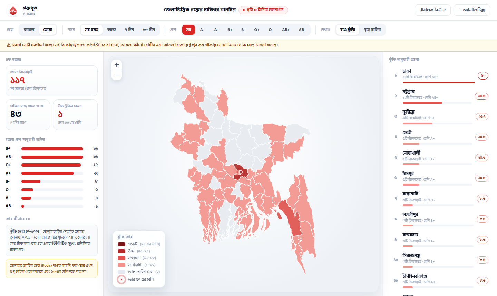
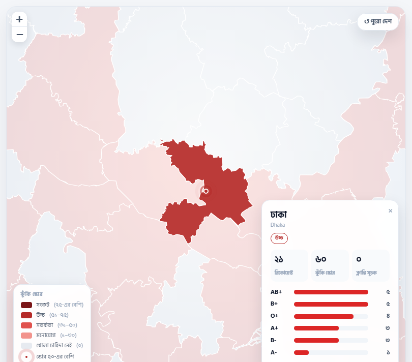

# RoktoDut (রক্তদূত)

**A blood-donation platform for Bangladesh, with a data and machine-learning layer that is measured before it is trusted.**

[](https://github.com/jahidstm/RoktoDut---Blood-Donation-Platform/actions/workflows/ci.yml)


RoktoDut helps a patient's family find eligible blood donors nearby without exposing donors'
phone numbers to everyone. The interface is in Bangla. It started as a university team
project; I then added matching rules, Bangla text understanding, analytics, spam triage, a
retrieval-based chatbot and demand forecasting.

> **Project status: not launched, no real users yet.** The local database holds generated
> donors and only a handful of real requests. Every ML result below comes from author-written
> test sets or simulators. The point of this repository is the method: how features are
> built, measured and gated so that they are ready for real data.



<sub>Admin demand heatmap. The requests shown are synthetic and the page says so.</sub>

## Contents

- [Features](#features)
- [Data and machine learning](#data-and-machine-learning)
- [Screenshots](#screenshots)
- [Architecture](#architecture)
- [Privacy and safety](#privacy-and-safety)
- [Tech stack](#tech-stack)
- [Getting started](#getting-started)
- [Testing](#testing)
- [Documentation](#documentation)
- [Limitations](#limitations)
- [Credits](#credits)

## Features

**For patients and families**

- Post, track and cancel blood requests, or send an emergency SOS.
- Paste a Bangla, English or Banglish message and get the request form pre-filled.
- Search donors by blood group and location, and see open demand on a public map.
- Set up recurring requests for long-term patients.

**For donors**

- Alerts for compatible, eligible requests (in-app, Firebase push, Telegram).
- Donation records, a health ledger, response reliability, points, badges and a leaderboard.
- A shareable donor card with a QR verification page.

**For organisations and admins**

- Organisation dashboard: member verification and alerts to eligible members.
- Admin dashboard: verification queues, spam review, audit log, analytics, heatmap and forecast.

**Also:** ambulance and blood-bank directories, a health blog, a chatbot that cites its
sources, and an installable PWA with an offline page.

## Data and machine learning

Each feature was built against a baseline and an evaluation set. **Two of the eight
deliberately ship without ML**, because testing did not justify it.

| # | Feature | Approach | Measured result | Ships with |
|---|---|---|---|---|
| 1 | **Donor matching** | Hard rules for eligibility, per-component compatibility and distance; ranking by smoothed response rate | 180-case PHP-vs-SQL parity test, 64-pair compatibility test | Rules |
| 2 | **Donor reliability** | Beta-smoothed response rate with confidence levels; outcomes logged as accepted, declined, ignored or *moot* | Unit-tested definitions shared with the ranking | Rules |
| 3 | **Message to request form** | Rules first (regex, Unicode normalisation, Bangla digits); an optional LLM only fills gaps, with phone masking and quote verification | 100% blood-group accuracy on 80 held-out, author-written posts; hospital 97.5%, district 98.8% | Rules, optional LLM |
| 4 | **Admin analytics** | Portable SQL aggregation; fulfilment rate on mature requests only; labelled demo-data generator; Power BI export | Tested on fixed fixtures | Descriptive statistics |
| 5 | **Fake and spam triage** | Eight explainable rules feed an admin review queue; **nothing is auto-blocked** | Tested per rule | Rules and human review |
| 6 | **Will this donor respond?** | Leak-free point-in-time features, time split, three models against four baselines, bootstrap promotion gate | On realistic simulation the model did **not** beat the existing rule (ΔNDCG@10 −0.001, CI −0.004 to 0.002) | **Rules (ML gated off)** |
| 7 | **Chatbot (RAG)** | Safety rules, Gemini embeddings, grounded answer with cited source; keyword fallback | Rephrased questions: 15/15 with embeddings, 6/15 with keywords; 10/10 personal medical questions refused | Retrieval and LLM |
| 8 | **Weekly demand forecast** | 64 division × blood-group series; ETS and global LightGBM against four baselines; rolling-origin backtest | Simulated seasonal data: LightGBM 8–13% lower WAPE in 8/8 seeds; gate promoted it in 6/8, and in 0/8 on pure noise | Best method per backtest |

The parser test set is small and written by the project author, so these figures are **not**
an estimate of accuracy on real posts.

### When ML was not the answer

**Donor response prediction.** The repository originally shipped a LightGBM model trained on
rows generated from a hand-written formula, so it only re-learned that formula. I replaced it
with a proper pipeline:

- the response-rate feature is recomputed **point in time**, using only outcomes known when
  the donor was notified;
- data is split by time, so models are always tested on later requests;
- models are ranked per request (hit@k, NDCG, MRR) against simple baselines;
- a model is promoted only if the bootstrap interval of its gain is above zero.

On a realistic simulator **the model did not beat the existing dispatch rule** (4 seeds).
Within one request every candidate shares the same hour, weekday and urgency, so only
distance, history and days since donation can change the order, and the rule already uses
them. Two controls show the gate works: it rejects pure noise, and it accepts when the
simulator contains non-linear structure the rule misses (+0.075 NDCG@10, CI 0.047 to 0.104).
Until a model trained on real data passes, the ML service answers `503` and Laravel uses its
rules.

**Spam detection.** There are no labelled fake requests, so this is explainable rules plus a
review queue whose decisions become the labels.

### How results are kept honest

- **Baselines first.** Each model is compared with what it would replace.
- **Gates.** A model is used only if it beats the best baseline on data it was not chosen on.
- **Negative and positive controls.** Each gate must say no when there is nothing to learn,
  and yes when there is real structure.
- **Held-out sets written first.** The NLP test set was committed before the parser existed.
- **No silent tuning.** Decisions changed after seeing results are recorded in the feature's
  document, such as switching the forecast metric from MASE to WAPE.
- **Synthetic data is labelled.** Demo requests carry `is_demo`, never appear on the public
  map, and pages built on them show a banner.

## Screenshots

All figures come from demo or simulated data.

| Demand forecast | Chatbot citing its source |
|---|---|
|  |  |



## Architecture


Laravel owns the data and every rule that affects safety (eligibility, blood compatibility,
blocking). The Python service only parses text and ranks within rule-approved candidates.
Training and forecasting run offline on anonymised exports.

## Privacy and safety

- Seeing a donor's phone number requires a login and a captcha, with a daily limit. Hidden
  numbers are never returned.
- Eligibility intervals and compatibility are **policy in config**, never learned.
- The chatbot never sends name, blood group, district or history to the LLM. It masks phone
  numbers and emails, and gives fixed answers to emergencies and personal medical questions.
- Training exports replace donor ids with a keyed hash and drop names, phones and coordinates.
- Reports on a request are evidence for a human reviewer; they never hide it automatically.
- The ML service refuses to start without an API key.
- Demo account seeders do nothing in production.

## Tech stack

| Area | Tools |
|---|---|
| Web application | Laravel 12, PHP 8.2, MySQL, Blade, Tailwind CSS, Alpine.js, Sanctum, Reverb |
| Maps and charts | Leaflet with GeoJSON, Chart.js |
| Integrations | Firebase Cloud Messaging, Telegram Bot API, Google sign-in, PWA |
| Data and ML | Python 3.12, FastAPI, pandas, NumPy, scikit-learn, LightGBM, statsmodels, Power BI export |
| LLM | Gemini (embeddings and generation), Groq (optional) |
| Quality | PHPUnit, pytest, GitHub Actions |

## Getting started

### Requirements

- PHP 8.2+ and Composer
- Node.js 20.19+ or 22.12+
- MySQL 8+ (seeding uses MySQL-specific statements)
- Python 3.12, only for the ML service
- Redis, optional: without it the donor-fatigue score is unavailable

### Web application

```bash
git clone https://github.com/jahidstm/RoktoDut---Blood-Donation-Platform.git
cd RoktoDut---Blood-Donation-Platform

composer install
npm install
cp .env.example .env          # Windows: copy .env.example .env
php artisan key:generate
```

Create an empty database, then set it in `.env` (the example file defaults to SQLite):

```ini
DB_CONNECTION=mysql
DB_HOST=127.0.0.1
DB_PORT=3306
DB_DATABASE=roktodut
DB_USERNAME=root
DB_PASSWORD=
```

```bash
php artisan migrate --seed                      # first-time setup only: reloads location tables
php artisan db:seed --class=HospitalSeeder
php artisan storage:link
npm run build
php artisan serve                               # http://127.0.0.1:8000
```

Run these in separate terminals for notifications and scheduled tasks:

```bash
php artisan queue:work
php artisan schedule:work
```

The app serves built assets by default. For Vite hot reload, set `VITE_DEV_SERVER=true` and
run `npm run dev`.

**Local demo admin:** `admin@roktodut.test` / `password`. This account is not created in
production; use `php artisan app:create-admin you@example.com` there.

### Optional services

Each is configured in `.env`.

| Feature | Variables |
|---|---|
| Chatbot generation and embeddings | `GEMINI_API_KEY` |
| ML service | `ROKTODUT_ML_API_KEY`, `ROKTODUT_ML_BASE_URL` |
| LLM gap-filling in the text parser | `GROQ_API_KEY` |
| Push notifications | `FIREBASE_*` |
| Telegram bot | `TELEGRAM_*` |
| Google sign-in | `GOOGLE_*` |
| Live updates (`php artisan reverb:start`) | `BROADCAST_CONNECTION=reverb`, `REVERB_*`, `VITE_REVERB_*` |

### ML service

Set `ROKTODUT_ML_API_KEY` first.

```bash
cd roktodut-ml-service
pip install -r requirements.txt
uvicorn main:app --host 127.0.0.1 --port 8001

# Offline training and forecasting on simulated data (or pass --input <export>)
python scripts/train_ranker.py --simulate realistic
python scripts/forecast_demand.py --simulate seasonal
```

### Data commands

```bash
php artisan demo:generate-demand          # synthetic requests for the dashboards (--purge removes them)
php artisan chatbot:eval                  # retrieval and safety scores
php artisan ml:export-response-logs       # anonymised training data
php artisan analytics:export              # one row per request, for Power BI or forecasting
```

## Testing

```bash
php artisan test                               # 193 tests, in-memory SQLite
cd roktodut-ml-service && python -m pytest     # 100 tests
```

GitHub Actions runs both suites on pull requests and on pushes to `main`.

Testing against real data paths also exposed problems in the original code, all since fixed:

- A request with a map pin matched **no donors**, because no donor had coordinates.
- The **report button never worked**: the controller was missing its model imports.
- **Three reports auto-hid any request**, so three accounts could take down a real emergency.
- The heatmap ignored `approved` requests, which were most of the open demand.
- The emergency exemption from fatigue exclusion never applied, because of a letter-case mismatch.
- Donor registration returned a server error on machines without the Redis extension.
- The hospital seeder linked hospitals to the **wrong districts**.
- On MySQL, requests **never expired** and admins could not reject a donation, because the
  status columns lacked those values. SQLite tests had not caught it.

## Documentation

| Topic | Document |
|---|---|
| Donor response model | [docs/ml/RESPONSE_MODEL.md](docs/ml/RESPONSE_MODEL.md) |
| Chatbot and retrieval | [docs/ml/CHATBOT_RAG.md](docs/ml/CHATBOT_RAG.md) |
| Demand forecast | [docs/ml/DEMAND_FORECAST.md](docs/ml/DEMAND_FORECAST.md) |
| Text parser evaluation | [roktodut-ml-service/data/nlp/README.md](roktodut-ml-service/data/nlp/README.md) |
| Data dictionary | [docs/data/DATA_DICTIONARY.md](docs/data/DATA_DICTIONARY.md) |
| Power BI export | [docs/analytics/POWER_BI.md](docs/analytics/POWER_BI.md) |

## Limitations

- No real users or outcomes yet. Every ML figure comes from simulators or author-written sets.
- Medical thresholds (donation intervals, haemoglobin, age, weight) have not been verified by
  a transfusion authority, and the public FAQ still disagrees with the app on intervals.
- The response model would learn only from donors the rules already chose (selection bias),
  so it needs deliberate exploration before it can be trusted.
- Not yet deployed or independently security tested.
- RoktoDut connects people. It does not give medical advice; hospitals do the screening and
  cross-matching.

## Credits

**[Jahid Hasan](https://github.com/jahidstm)** ([LinkedIn](https://www.linkedin.com/in/jahidstm/))
built the data and ML layer described here, and was lead on backend, database and security
for the original application.

The original web application was a team project with Md. Alif Khan, Nohzat Tabassum and
Mst. Moumita Rahman Meem.

## License

No `LICENSE` file is included yet. `composer.json` declares MIT for the application package,
but the licence of the repository as a whole has not been decided.
