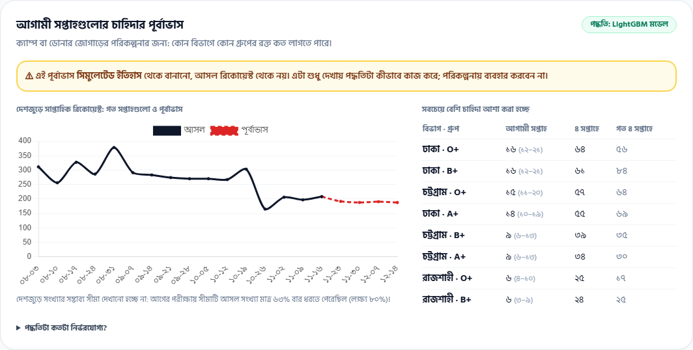
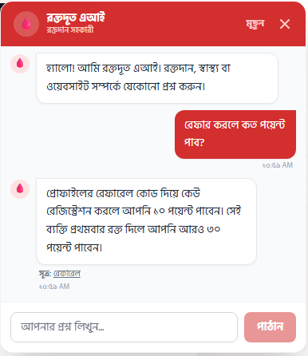
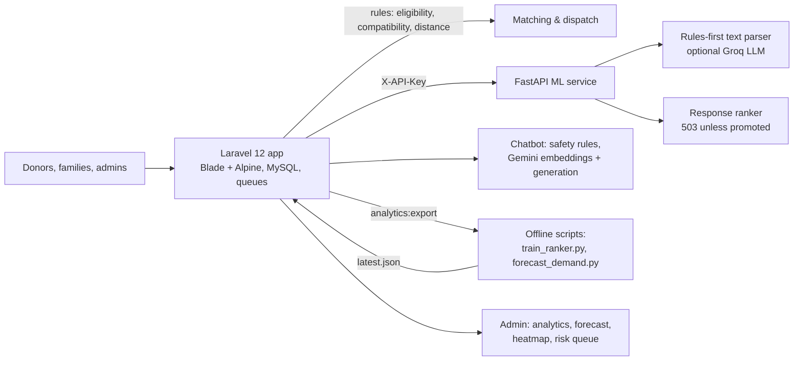

# RoktoDut (রক্তদূত): blood-donor matching with a measured ML layer

[](https://github.com/jahidstm/RoktoDut---Blood-Donation-Platform/actions/workflows/ci.yml)

RoktoDut is a Laravel platform that helps patients' families in Bangladesh find blood donors
quickly without exposing donors' phone numbers to everyone. It began as a university web
project. I then added a data and machine-learning layer: matching, text understanding,
analytics, spam triage, a retrieval-based chatbot, and forecasting.

Each feature was built against a baseline and an evaluation set. **Two of the eight
deliberately ship without ML**, because the tests showed simple rules were as good.

> **Read this first: there are no real users yet.** The local database holds about 10,000
> generated donors and four real blood requests. Every ML result below comes from
> author-written test sets or simulators, and each one says so. The point of this repository
> is the method: how features are built, measured and gated so they are ready for real data.


---

## What I built

| # | Feature | Approach | Measured result | Ships with |
|---|---|---|---|---|
| 1 | **Donor matching** | Hard rules: eligibility, per-component blood compatibility, distance; ranking by smoothed response rate | 180-case PHP-vs-SQL parity test, 64-pair compatibility test | Rules |
| 2 | **Donor reliability** | Beta-smoothed response rate with confidence levels; outcomes logged as accepted / declined / ignored / *moot* | Unit-tested definitions shared with the ranking | Rules |
| 3 | **Message → request form** (Bangla / English / Banglish) | Rules first (regex, Unicode normalisation, Bangla digits); optional LLM fills gaps only, with phone masking and quote verification | 100% on 80 held-out author-written posts (no wrong blood group; it abstains instead); hospital 97.5%, district 98.8% | Rules + optional LLM |
| 4 | **Admin analytics** | Portable SQL/pandas-style aggregation; fulfilment rate on mature requests only; labelled demo-data generator; Power BI export | Tested on fixed fixtures | Descriptive stats |
| 5 | **Fake / spam triage** | 8 explainable rules → admin review queue. **Never auto-blocks.** Reviews become labels | Tested per rule | Rules + human review |
| 6 | **Will this donor respond?** | Leak-free point-in-time features, time split, LR / Random Forest / LightGBM vs 4 baselines, bootstrap promotion gate | On realistic simulation the model did **not** beat the existing rule (ΔNDCG@10 −0.001, CI −0.004 to 0.002) | **Rules (ML gated off)** |
| 7 | **Chatbot (RAG)** | Safety rules → Gemini embeddings → grounded answer with cited source; keyword fallback | Rephrased questions: 15/15 (embeddings) vs 6/15 (keywords); 10/10 personal-medical questions refused | Retrieval + LLM |
| 8 | **Weekly demand forecast** | 64 division × blood-group series; ETS and global LightGBM vs 4 baselines; rolling-origin backtest; calibrated intervals | Simulated seasonal data: LightGBM 8–13% lower WAPE in 8/8 seeds; gate promoted 6/8, and 0/8 on pure noise | Best method per backtest |

Full write-ups: [response model](docs/ml/RESPONSE_MODEL.md) ·
[chatbot](docs/ml/CHATBOT_RAG.md) · [forecast](docs/ml/DEMAND_FORECAST.md) ·
[NLP evaluation](roktodut-ml-service/data/nlp/README.md) ·
[data dictionary](docs/data/DATA_DICTIONARY.md) · [Power BI](docs/analytics/POWER_BI.md)

---

## When ML was not the answer

**Feature 6, donor response prediction.** The repository originally shipped a LightGBM
model trained on rows generated from a hand-written formula, so it only re-learned that
formula. I replaced it with a proper pipeline:

- the response-rate feature is recomputed **point in time**: only outcomes known at
  notification time are used;
- the data is split by time, so the model is always tested on later requests;
- three models are compared with four baselines, ranked per request (hit@k, NDCG, MRR);
- a promotion gate requires a bootstrap interval above zero.

The result on a realistic simulator was that **the model did not beat the existing dispatch
rule** (4 seeds). The reason is structural. Inside one request every candidate shares the
same hour, weekday and urgency, so only distance, history and days since donation can
change the order, and the rule already uses them.

Two controls show the gate is not simply broken. It refuses pure noise. It accepts when
the simulator contains non-linear structure the rule misses: +0.075 NDCG@10, CI 0.047 to
0.104. The ML service answers `503` until a model trained on **real** data passes the
gate, and Laravel keeps its rules.

**Feature 5, spam detection.** There are no labelled fake requests, so the feature is
explainable rules plus a review queue whose decisions become the labels. An Isolation
Forest can come later, and only to order the queue.

---

## How results are kept honest

- **Baselines first.** Every model is compared with the thing it would replace: nearest
  donor, current dispatch score, moving averages, keyword search.
- **Gates.** A model is used only if it beats the best baseline by a margin on data it did
  not choose itself on. Otherwise the baseline runs, and the UI names it.
- **Negative and positive controls.** Each gate is run on a simulation with nothing to learn
  (it must say no) and one with real structure (it should say yes).
- **Held-out sets written first.** The NLP test set was committed before the parser existed.
  The chatbot's rephrased questions were added after the first retriever. Its 100% score on
  the original set was misleading, and the rephrased set showed that.
- **No silent tuning.** Decisions changed after seeing results are written down in the
  feature's doc (for example, switching the forecast metric from MASE to WAPE).
- **Synthetic is always labelled.** Demo requests carry `is_demo`. The public map never
  shows them. Every page built on them shows a banner.

---

## Screenshots (demo data)

| Demand forecast on admin analytics | Chatbot citing its source |
|---|---|
|  |  |


---

## Bugs found in the original code

Building on real data paths surfaced problems that had been invisible:

- A request with a map pin matched **zero donors**, because no donor had coordinates. Fixed
  with a same-district fallback (0 → 14 donors on the local DB).
- The **"report" button never worked**: the controller was missing its model imports.
- **Three reports auto-hid any request**, so three accounts could take down a real
  emergency. Reports are now evidence for a human.
- The heatmap ignored **`approved` requests**, which was most open demand, after a status rename.
- Fatigue exclusion compared against `'EMERGENCY'` while values were lowercase, so the
  emergency exemption never applied.
- `catch (\Exception)` around Redis missed `Error` ("class not found"), so donor
  registration returned 500 on machines without the Redis extension.
- The hospital seeder linked hospitals to the **wrong districts** through hard-coded ids.

---

## Architecture



Laravel owns the data and every rule that affects safety (eligibility, blood compatibility,
blocking). The Python service only parses text and ranks within rule-approved candidates.
Training and forecasting run offline on anonymised exports.

## Privacy and safety

- Eligibility intervals and compatibility are **policy in config**, never learned, and
  flagged as needing confirmation against a transfusion guideline.
- The chatbot never sends name, blood group, district or history to the LLM. It masks
  phones and emails, and gives fixed answers to emergencies and personal medical questions.
- Training exports replace donor ids with a keyed hash and drop names, phones and coordinates.
- No secret defaults in config; the ML service refuses to start without its key.
- Seeing a donor's phone number needs a login and is rate limited; hidden numbers are never returned.
- In production the demo seeders do nothing; create the first admin with `php artisan app:create-admin you@example.com`.

## Tech stack

**App:** Laravel 12 (PHP 8.2), MySQL, Redis, Sanctum, Reverb, Blade, Tailwind, Alpine.js,
Chart.js, Leaflet/GeoJSON, Firebase, Telegram, PWA.
**Data / ML:** Python 3.12, FastAPI, pandas, NumPy, scikit-learn, LightGBM, statsmodels,
Gemini (embeddings + generation), Groq (optional), Power BI (export).
**Quality:** PHPUnit (188 tests), pytest (100 tests), GitHub Actions, Playwright screenshots.

---

## Run it

Prerequisites: PHP 8.2+, Composer, Node 18+, MySQL 8+, Python 3.12. Redis is needed for
the donor-fatigue score; matching, registration and the heatmap still work without it.

```bash
composer install && npm install
cp .env.example .env            # Windows: copy .env.example .env
php artisan key:generate
php artisan migrate
npm run build
composer run dev
```

Optional, after `php artisan migrate`:

```bash
php artisan demo:generate-demand          # labelled synthetic requests for the dashboards
php artisan chatbot:eval                  # retrieval and safety scores
php artisan ml:export-response-logs       # anonymised training data
php artisan analytics:export              # one row per request, for Power BI / forecasting
```

ML service (set `ROKTODUT_ML_API_KEY` in `.env` first):

```bash
pip install -r roktodut-ml-service/requirements.txt
cd roktodut-ml-service
uvicorn main:app --host 127.0.0.1 --port 8001
python scripts/train_ranker.py --simulate realistic      # or --input <export>
python scripts/forecast_demand.py --simulate seasonal    # or --input <export>
```

Tests: `php artisan test` and `cd roktodut-ml-service && python -m pytest`.

## Limitations

- No real users or outcomes yet. Every ML number is from simulators or author-written sets.
- Medical numbers (donation intervals, haemoglobin, age, weight) are not verified by a
  transfusion authority, and the public FAQ page still disagrees with the app on intervals.
- The response model would learn only from donors the rules already chose (selection bias).
  It needs exploration before it can be trusted.
- RoktoDut connects people; it is not medical advice. Hospitals do screening and cross-matching.

## Team

Jahid Hasan built the data and ML layer described here and was lead on backend, database
and security for the original app ([GitHub](https://github.com/jahidstm) ·
[LinkedIn](https://www.linkedin.com/in/jahidstm/)). The original web application was a team
project with Md. Alif Khan, Nohzat Tabassum and Mst. Moumita Rahman Meem.

No `LICENSE` file is included yet. `composer.json` declares MIT for the application
package, but the licence of the repository as a whole has not been decided.
