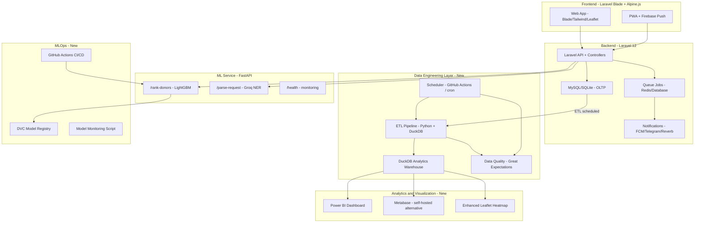

# 🩸 RoktoDut — Data-Driven Portfolio রূপান্তর পরিকল্পনা

> **তারিখ:** ২০২৬-১০-১৭ | **প্রস্তুতকারী:** AI/ML Engineering Advisor
> **edu mail মেয়াদ:** ~১ বছর বাকি | **দৈনিক সময়:** ২–৩ ঘণ্টা

---

## ১. Repo অডিটের সারসংক্ষেপ

### ১.১ বর্তমান Feature তালিকা (কোড থেকে যাচাই করা)

| বিভাগ | Feature | যাচাই |
|-------|---------|-------|
| **Auth** | Google OAuth, Sanctum SPA auth, role-based (admin/donor/org_admin/user) | ✅ `UserRole` enum, Sanctum config |
| **Donor Search** | No-login emergency search, Haversine distance, blood group matching, cooldown check, availability calendar (bitmask) | ✅ `DonorMatchingService`, `SearchController` |
| **Blood Requests** | Create/track requests, urgency levels (Normal/Urgent/Emergency), guest requests, auto-expire, SOS broadcast | ✅ `BloodRequestController`, `EmergencySosController` |
| **Response Tracking** | Accept/decline/ignore, response logging, cascade dispatch | ✅ `BloodRequestResponseController`, `DonorResponseLog` model |
| **Donations** | Claim workflow, recipient confirmation, offline claims, auto-approve, certificates | ✅ `DonationClaimController`, `CertificateController` |
| **Gamification** | Points, badges, leaderboard, DFI (Donor Fatigue Index) | ✅ `GamificationService` (39KB!), `LeaderboardController` |
| **Organizations** | Blood clubs, hospitals, blood bank inventory, camp management | ✅ `Organization`, `Hospital`, `BloodInventory`, `BloodCamp` models |
| **Privacy/Security** | Masked phone, phone reveal rate-limit, QR tokens, NID retention policy, shadowban, audit logs, CAPTCHA | ✅ Multiple migrations, `PhoneRevealLog`, `SecurityRadarEvent` |
| **Notifications** | Firebase FCM push, Telegram bot, 20+ notification classes, Reverb WebSocket | ✅ `FcmDispatchService`, `TelegramService`, `Notifications/` dir |
| **Chatbot** | Gemini-powered FAQ chatbot with live inventory context | ✅ `ChatbotController` — uses Gemini API |
| **Spatial** | Leaflet heatmap, CRS score (demand+DFI), GeoJSON districts, Redis-backed | ✅ `SpatialAnalyticsService` |
| **ML Service** | FastAPI microservice: donor ranking (LightGBM) + NLP request parsing (Groq/LLaMA) | ✅ `roktodut-ml-service/` — working code |
| **Chronic Care** | Thalassemia/Dialysis subscriptions, buddy system, rotation | ✅ `ChronicRequestSubscription` model |
| **Content** | Blog/Success stories, moderation, categories, reporting | ✅ `BlogSubmissionController`, `Post` model |
| **PWA** | Progressive Web App support | ✅ `PwaController`, manifest |

### ১.২ Database Schema সারসংক্ষেপ

**৯৫টি migration ফাইল** — মোট ৪৩টি Eloquent model:

| প্রধান টেবিল | Key Fields | সম্পর্ক |
|-------------|-----------|---------|
| `users` | blood_group, lat/lng, district/division/upazila IDs, is_donor, cooldown_until, last_donated_at, total_donations, points, badges, qr_token, DFI fields, NID, shadowban, FCM token, Telegram | Has many: donations, responses, requests, badges |
| `blood_requests` | blood_group, urgency, district, lat/lng, status, bags_needed, component_type, guest fields, hospital_id, AI dispatch fields | Belongs to: user, district, hospital |
| `blood_request_responses` | request_id, donor_id, status (accepted/declined/ignored/pending), fulfilled_at | Belongs to: request, donor |
| `donations` | donor_id, request_id, response_id, status, journey_status, certificate_token | Belongs to: donor, request |
| `donor_response_logs` | request_id, donor_id, notified_at, responded_at, status, response_time_minutes, distance_km, days_since_last_donation | ML training data source |
| `donor_telemetry_logs` | donor_id, event_type, payload | Behavioral tracking |
| `hospitals` | name, district, lat/lng, type, verified | GeoJSON capable |
| `blood_inventories` | organization_id, blood_group, units_available | Blood bank stock |
| `donor_availabilities` | user_id, type (weekly/specific_date/date_range), weekdays_bitmask, time slots | Calendar system |
| Location tables | `divisions`, `districts`, `upazilas` — Bangladesh admin hierarchy | Seeded: 8 divs, 64 districts |

### ১.৩ ডেটা ইনভেন্টরি

| ডেটা উৎস | পরিমাণ | মন্তব্য |
|-----------|--------|---------|
| **Seed data** | ৩০+ demo donors, admin, hospitals (১২+), blogs, badges, locations (64 districts) | `DatabaseSeeder` — structured demo data |
| **SQLite DB** | ~672 KB (`database.sqlite`) | Development DB, সম্ভবত seed data + কিছু manual test data |
| **ML Synthetic CSV** | `donor_response_logs_synthetic.csv` — ~632KB, ৮০০০ rows | `bootstrap_data.py` দিয়ে তৈরি |
| **Trained Model** | `donor_ranker.joblib` — ~1.1MB LightGBM | Synthetic data-তে trained |
| **Real production data** | ❌ **নেই** | কোনো real user, request, বা donation data নেই |

### ১.৪ টেকনিক্যাল ঋণ ও সমস্যা

| সমস্যা | তীব্রতা | বিবরণ |
|--------|---------|-------|
| **Root-level temp files** | 🟡 মাঝারি | `fix_all_tokens.php`, `test_*.php`, `restructure_dashboard.py`, `temp_head*.blade.php` — production-ready নয় |
| **`.env` committed** | 🔴 উচ্চ | `.env` ফাইল repo-তে আছে (2.2KB) — credentials exposed হতে পারে |
| **`firebase_credentials.json`** | 🔴 উচ্চ | Root-এ Firebase credentials — `.gitignore`-এ থাকা উচিত |
| **Encoding issue** | 🟡 মাঝারি | `.env.example` শেষে UTF-16 encoded line (`TELEGRAM_ADMIN_CHAT_ID`) |
| **No LICENSE file** | 🟡 মাঝারি | `composer.json` MIT বলে কিন্তু dedicated LICENSE নেই |
| **No automated tests** | 🟡 মাঝারি | `.phpunit.result.cache` আছে কিন্তু `tests/` ফোল্ডারে substantive test যাচাই করা যায়নি |
| **SQLite for dev** | 🟢 কম | `.env.example`-এ `DB_CONNECTION=sqlite` — production-এ MySQL/PostgreSQL দরকার |
| **Queue: database driver** | 🟢 কম | `QUEUE_CONNECTION=database` + cron fallback — production-এ Redis preferable |

### ১.৫ Authentication, Notification, Background Jobs, Deployment

| বিষয় | বর্তমান অবস্থা |
|-------|----------------|
| **Auth** | Sanctum + Google OAuth — ভালো |
| **Notifications** | Firebase FCM + Telegram + WebSocket (Reverb) + Database — সম্পূর্ণ |
| **Background Jobs** | Laravel Queue (database driver), ৬টি Job class, Scheduled commands (expire, auto-approve, DFI decay, NID purge, cooldown reminders) — কাজ করে |
| **Deployment** | যাচাই করা যায়নি — কোনো Dockerfile, CI/CD config, বা deployment script দেখা যায়নি |

---

## ২. Feature ম্যাট্রিক্স

### ২.১ মূল্যায়ন মাপকাঠি

- **ক্যারিয়ার মূল্য** (১–৫): Data Analyst/Scientist/Engineer/ML Engineer role-এ কতটা প্রাসঙ্গিক
- **কঠিনতা** (১–৫): ১=সহজ, ৫=কঠিন
- **ডেটা প্রস্তুতি** (১–৫): ১=সব আছে, ৫=সব বানাতে হবে
- **Phitron মিল**: কোর্সের কোন টপিকের সাথে যায়

> ⚠️ **Phitron সিলেবাস সম্পর্কে:** Phitron-এর পেজ (phitron.io/ai-ml-course) একটি JavaScript SPA — সিলেবাস সরাসরি parse করা সম্ভব হয়নি। নিচে Phitron-এর সাধারণ AI/ML কোর্স কাঠামো অনুসারে ম্যাপ করা হয়েছে। **তুমি নিজের কোর্স পেজ থেকে exact module নাম verify করে এই তালিকা আপডেট করো।**

### ২.২ Feature ম্যাট্রিক্স

| # | Feature | ক্যারিয়ার | কঠিনতা | ডেটা | ফ্রি টুল | Phitron মিল | ML দরকার? | অগ্রাধিকার |
|---|---------|-----------|---------|------|----------|-------------|-----------|-----------|
| **F1** | ETL Pipeline (Laravel DB → Analytics DuckDB) | ⭐⭐⭐⭐⭐ | ⭐⭐ | ⭐⭐ | DuckDB, GitHub Actions, Python | Data Engineering, SQL | ❌ Rule-based | 🥇 **১** |
| **F2** | Operational Dashboard (Power BI / Metabase) | ⭐⭐⭐⭐⭐ | ⭐⭐ | ⭐⭐ | Metabase (self-hosted), Power BI Desktop | Data Visualization | ❌ Rule-based | 🥇 **২** |
| **F3** | Data Quality Framework | ⭐⭐⭐⭐ | ⭐⭐ | ⭐ | Great Expectations (Python), GitHub Actions | Data Engineering | ❌ Rule-based | 🥇 **৩** |
| **F4** | Donor Ranking ML (উন্নতি) | ⭐⭐⭐⭐⭐ | ⭐⭐⭐ | ⭐⭐⭐ | scikit-learn, LightGBM, SHAP | Supervised Learning, Feature Engineering | ✅ কিন্তু rule-based baseline আছে | 🥈 **৪** |
| **F5** | NLP Request Parser (উন্নতি) | ⭐⭐⭐⭐ | ⭐⭐⭐ | ⭐⭐⭐⭐ | Groq Free API (LLaMA), HuggingFace | NLP, Text Processing | ✅ LLM-ভিত্তিক | 🥈 **৫** |
| **F6** | Geospatial Heatmap (উন্নতি) | ⭐⭐⭐⭐ | ⭐⭐ | ⭐⭐ | Leaflet, DuckDB Spatial | Data Visualization, Geospatial | ❌ Rule-based (CRS score) | 🥈 **৬** |
| **F7** | CI/CD + Model Versioning | ⭐⭐⭐⭐ | ⭐⭐ | ⭐ | GitHub Actions, DVC (open-source) | MLOps | ❌ Automation | 🥈 **৭** |
| **F8** | Demand Forecasting (Time-Series) | ⭐⭐⭐⭐⭐ | ⭐⭐⭐⭐ | ⭐⭐⭐⭐⭐ | Prophet/statsmodels | Time-Series, Forecasting | ⚠️ সতর্কতা নিচে | 🥉 **৮** |
| **F9** | Anomaly Detection (ভুয়া request) | ⭐⭐⭐⭐ | ⭐⭐⭐ | ⭐⭐⭐⭐ | scikit-learn (Isolation Forest) | Unsupervised Learning | ⚠️ সতর্কতা নিচে | 🥉 **৯** |
| **F10** | RAG Chatbot (উন্নতি) | ⭐⭐⭐⭐ | ⭐⭐⭐⭐ | ⭐⭐ | LangChain, FAISS, Gemini Free | RAG, LLM | ✅ কিন্তু current chatbot কাজ করে | 🥉 **১০** |
| **F11** | Donor Response Prediction | ⭐⭐⭐⭐ | ⭐⭐⭐ | ⭐⭐⭐⭐ | scikit-learn | Classification | ⚠️ F4-এর সাথে overlap | 🏅 **১১** |

### ২.৩ সততার মূল্যায়ন — ML কোথায় দরকার, কোথায় নয়

#### ✅ ML সঠিকভাবে ব্যবহৃত হচ্ছে:
- **F4 (Donor Ranking):** ইতোমধ্যে LightGBM দিয়ে করা আছে। Rule-based fallback-ও আছে। ML এখানে justified কারণ multiple features-এর non-linear interaction capture করতে হয়। **তবে:** synthetic data-তে trained — real data ছাড়া production accuracy দাবি করা যাবে না।
- **F5 (NLP Parser):** বাংলা+ইংরেজি মিশ্র টেক্সট থেকে structured data extract করা — LLM/NLP ছাড়া কঠিন। ইতোমধ্যে Groq/LLaMA দিয়ে করা আছে।

#### ⚠️ ML ব্যবহার করা যায় কিন্তু সীমাবদ্ধতা আছে:
- **F8 (Demand Forecasting):** Real transaction data ছাড়া time-series model meaningless। **Synthetic data দিয়ে একটা working pipeline demo দেখানো যায়, কিন্তু forecast accuracy নিয়ে কোনো দাবি করা যাবে না।** Portfolio-তে স্পষ্ট লিখতে হবে "synthetic data demo"।
- **F9 (Anomaly Detection):** Real ভুয়া request-এর example ছাড়া "anomaly" define করা কঠিন। **Rule-based heuristic (যেমন: same IP থেকে ১০ মিনিটে ৫+ request, impossible blood group changes) বেশি কার্যকর এবং explainable।** ML লাগবে না — rule-based করো।
- **F11 (Donor Response Prediction):** F4-এর সাথে overlap — আলাদা করার দরকার নেই। Ranking model-ই response probability predict করে।

#### ❌ ML দরকার নেই:
- **F6 (Geospatial):** CRS score (60% demand + 40% DFI) rule-based — ভালো কাজ করে। ML দিয়ে শুধু CV সুন্দর করার দরকার নেই।
- **Smart Donor Ranking (blood compatibility, distance, eligibility):** ইতোমধ্যে `buildBaseQuery()`-এ rule-based — Haversine, cooldown, bitmask calendar। ML ranking শুধু probability ordering-এ যোগ করে, core eligibility rule-based-ই থাকবে।

---

## ৩. টার্গেট আর্কিটেকচার

### ৩.১ প্রবাহ ব্যাখ্যা

1. **OLTP (Laravel ↔ MySQL/SQLite):** সব transactional data এখানে — users, requests, donations
2. **ETL Pipeline:** Python script দিনে ১–২ বার OLTP থেকে data টানবে → clean/transform → DuckDB-তে লোড
3. **Analytics Warehouse (DuckDB):** File-based, serverless, ফ্রি। SQL দিয়ে aggregate queries চালানো যাবে
4. **Dashboard:** DuckDB-র ওপর Power BI (Desktop, ফ্রি) বা Metabase (Docker) connect করবে
5. **ML Service:** Laravel HTTP call করে FastAPI-তে → ranking/NLP result ফেরত পায়
6. **CI/CD:** GitHub Actions-এ model retrain → test → deploy pipeline

---

## ৪. ধাপে ধাপে Roadmap

### Phase 0: ভিত্তি ও পরিষ্কার-পরিচ্ছন্নতা (সপ্তাহ ১–২, ~৩০ ঘণ্টা)

| Task | সময় | Deliverable | সম্পন্ন শর্ত |
|------|------|-------------|-------------|
| Root-level temp files সরানো/`.gitignore` | ২ ঘণ্টা | Clean repo | `fix_*.php`, `test_*.php`, `temp_*.blade.php` সরানো |
| `.env` ও `firebase_credentials.json` git history থেকে remove | ৩ ঘণ্টা | Secure repo | `git filter-repo` দিয়ে history পরিষ্কার, `.gitignore` আপডেট |
| LICENSE file যোগ (MIT) | ০.৫ ঘণ্টা | `LICENSE` ফাইল | MIT license text |
| README.md আপডেট (architecture diagram, setup guide) | ৩ ঘণ্টা | Professional README | Mermaid diagram, badges, clear setup instructions |
| `.env.example` encoding fix | ০.৫ ঘণ্টা | Clean config | UTF-8 only |
| GitHub Actions basic CI (lint + test) | ৪ ঘণ্টা | `.github/workflows/ci.yml` | PR-এ auto-run, green check |
| Seed data পর্যালোচনা ও বিস্তার (৫০+ donors, ১০০+ requests, ৫০+ donations) | ৮ ঘণ্টা | `DatabaseSeeder` আপডেট | Realistic distribution, ৬ মাসের timeline |
| DuckDB setup + প্রথম ETL script | ৯ ঘণ্টা | `analytics/etl/extract.py` | SQLite → DuckDB, scheduled |

### Phase 1: MVP Data Pipeline + Dashboard (সপ্তাহ ৩–৬, ~৬০ ঘণ্টা)

| Task | সময় | Deliverable | সম্পন্ন শর্ত |
|------|------|-------------|-------------|
| **F1: ETL Pipeline সম্পূর্ণ করা** | ১২ ঘণ্টা | `analytics/` ফোল্ডার — extract, transform, load scripts | cron/GH Actions-এ automated run, logging |
| **F3: Data Quality Framework** | ৮ ঘণ্টা | Great Expectations suite | ৫+ validation rules, GH Actions-এ report |
| **F2: Power BI Dashboard** | ১৫ ঘণ্টা | `.pbix` ফাইল + screenshots | ৪+ page: overview, blood group analysis, geo, time trends |
| **F6: Heatmap Enhancement** | ৬ ঘণ্টা | Updated Leaflet map | Time-range filter, blood group filter (ইতোমধ্যে আছে — refine) |
| **F4: ML Model Enhancement** | ১২ ঘণ্টা | Updated training pipeline + SHAP explainability | Cross-validation, feature importance chart, SHAP notebook |
| **F7: CI/CD for ML** | ৭ ঘণ্টা | GitHub Actions workflow | `train → test → artifact upload` pipeline |

### Phase 2: Advanced Analytics + NLP (সপ্তাহ ৭–১২, ~৬০ ঘণ্টা)

| Task | সময় | Deliverable | সম্পন্ন শর্ত |
|------|------|-------------|-------------|
| **F5: NLP Parser Enhancement** | ১৫ ঘণ্টা | Evaluation dataset (৫০+ examples), accuracy report | precision/recall by field, edge case analysis |
| **F8: Demand Forecasting (Demo)** | ১৫ ঘণ্টা | Jupyter notebook + FastAPI endpoint | Prophet model, synthetic data-তে MAPE, **স্পষ্ট "demo" label** |
| **F9: Rule-based Anomaly Detection** | ১০ ঘণ্টা | `AnomalyDetectionService.php` | ৫+ rule, admin alert, audit log |
| Model monitoring dashboard | ৮ ঘণ্টা | Metrics tracking script | Prediction drift detection, weekly report |
| Metabase setup (Docker) | ৫ ঘণ্টা | `docker-compose.yml` | DuckDB-তে connect, ৩+ saved question |
| Documentation ও notebook polish | ৭ ঘণ্টা | `notebooks/` ফোল্ডার | EDA, training, evaluation notebooks |

### Phase 3: Stretch Goals (সপ্তাহ ১৩–১৬, যদি সময় থাকে)

| Task | সময় | Deliverable |
|------|------|-------------|
| **F10: RAG Chatbot** — FAISS vector store + eligibility KB | ১৫ ঘণ্টা | Enhanced chatbot with RAG |
| A/B testing framework for ranking | ১০ ঘণ্টা | Feature flag + metric comparison |
| Docker Compose full stack (Laravel + FastAPI + DuckDB + Metabase) | ১০ ঘণ্টা | One-command dev setup |
| Public dataset integration (WHO blood donation stats) | ৫ ঘণ্টা | Comparative analysis notebook |

---

## ৫. GitHub Student Pack ও ফ্রি রিসোর্স পরিকল্পনা

### ৫.১ "এখনই Claim করো" তালিকা

> ⚠️ **গুরুত্বপূর্ণ:** নিচের শর্তগুলো ২০২৬-১০-১৭ তারিখে education.github.com/pack পেজ থেকে পড়া হয়েছে। Student Pack offers পরিবর্তন হতে পারে — claim করার আগে পেজে গিয়ে সর্বশেষ শর্ত যাচাই করো।

| # | টুল | Pack-এ পাওয়া যায় | কোন Feature-এ লাগবে | কেন এখনই |
|---|------|-------------------|---------------------|----------|
| 1 | **GitHub Copilot** | ✅ Student Pro-তে ফ্রি | সব কোডিং কাজ | edu শেষ হলে paid হয়ে যাবে, এখনই activate করো |
| 2 | **GitHub Codespaces** | ✅ Student-দের জন্য ফ্রি hours | Cloud dev environment, ML training | GPU ছাড়াও useful |
| 3 | **DataCamp** | ✅ Pack-এ (Learn category) | ML/Data Science শেখা | edu শেষ হলে paid — courses complete করো |
| 4 | **Deepnote** | ✅ Pack-এ (ML & AI category) | Notebook collaboration, EDA | F4, F8 notebooks-এর জন্য |
| 5 | **Microsoft Azure** | ✅ $100 credit (Pack-এ) | Cloud hosting experiment (optional) | Credit expire হওয়ার আগে ব্যবহার করো |
| 6 | **SQLGate** | ✅ Pack-এ (Developer tools) | Database management | DB inspection-এ কাজে লাগবে |
| 7 | **Namecheap** | ✅ Pack-এ (free domain) | Portfolio deployment | `.me` domain claim করো |

### ৫.২ সবসময় ফ্রি টুল (edu মেয়াদ-নির্ভর নয়)

| টুল | ব্যবহার | Feature | মূল্য |
|------|---------|---------|-------|
| **DuckDB** | Analytics warehouse | F1, F2, F8 | সম্পূর্ণ ফ্রি, open-source |
| **GitHub Actions** | CI/CD, ETL scheduler | F1, F3, F7 | Public repo-তে ফ্রি (2000 min/month) |
| **Power BI Desktop** | Dashboard | F2 | Windows-এ ফ্রি |
| **Metabase** | BI tool (Docker) | F2 বিকল্প | Open-source, self-hosted |
| **Great Expectations** | Data quality | F3 | Open-source |
| **scikit-learn / LightGBM** | ML training | F4, F8, F9 | Open-source |
| **SHAP** | Model explainability | F4 | Open-source |
| **Groq API** | NLP (LLaMA 3) | F5 | Free tier (RP limit আছে) |
| **Gemini API** | Chatbot | F10 | Free tier (15 RPM) |
| **FAISS** | Vector search (RAG) | F10 | Open-source |
| **DVC** | Model versioning | F7 | Open-source |
| **Docker Desktop** | Container setup | All | Personal use ফ্রি |
| **Prefect** | Workflow orchestration | F1 বিকল্প | Open-source core |

### ৫.৩ মেয়াদ-পরবর্তী ফ্রি বিকল্প

| edu-dependent | মেয়াদ শেষে বিকল্প |
|---------------|-------------------|
| GitHub Copilot | Codeium (ফ্রি), Cursor (limited free) |
| DataCamp | Kaggle Learn (ফ্রি), fast.ai |
| Azure $100 credit | Oracle Cloud Free Tier (always free), Railway.app free tier |
| Deepnote | Google Colab (ফ্রি), Kaggle Notebooks |

---

## ৬. ডেটা কৌশল

### ৬.১ সমস্যা: Real Data নেই

এই প্রজেক্টে **কোনো real user data নেই**। সব ML feature synthetic বা seed data-র ওপর নির্ভর করবে। এটা সৎভাবে স্বীকার করতে হবে।

### ৬.২ ডেটা সোর্স পরিকল্পনা

| Feature | Real Data | Synthetic Data | Public Dataset | সীমাবদ্ধতা |
|---------|-----------|---------------|----------------|-----------|
| **F1 (ETL)** | Seed data (৫০+ users, ১০০+ requests) | Factory-generated expansions | ❌ | Pipeline ডিজাইন showcase, volume কম |
| **F2 (Dashboard)** | Seed data | Factory-generated ৬ মাসের data | ❌ | Real trends নয়, pattern demonstrate করাই উদ্দেশ্য |
| **F4 (Ranking)** | `donor_response_logs` টেবিল (empty) | `bootstrap_data.py` — ৮০০০ rows | ❌ | **স্পষ্ট label: "Trained on synthetic data. Real-world accuracy unverified."** |
| **F5 (NLP)** | ❌ | হাতে লেখা ৫০+ বাংলা/ইংরেজি blood request text | Facebook blood request groups (public posts) | Test examples manually curated |
| **F8 (Forecasting)** | ❌ | Simulated daily request counts (৩৬৫ দিন) | WHO Global Blood Safety (country-level) | **"Demo pipeline only. Forecast accuracy not applicable to real demand."** |
| **F9 (Anomaly)** | ❌ | ❌ | ❌ | Rule-based, ML নয় — anomaly definition হাতে তৈরি |

### ৬.৩ Synthetic Data তৈরির নীতি

1. **Reproducibility:** সব synthetic data script `scripts/` ফোল্ডারে থাকবে, `--seed` parameter সহ
2. **Realistic distributions:** Bangladesh-এর blood group distribution (B+ ~35%, O+ ~30%, A+ ~20%, ...) মানতে হবে
3. **স্পষ্ট labeling:** প্রতিটা CSV-তে `_synthetic` suffix, README-তে সতর্কতা
4. **No leakage:** Training/test split synthetic generation-এর সময়ই আলাদা করতে হবে

---

## ৭. Evaluation ও Testing পরিকল্পনা

### ৭.১ ML Model Evaluation

| Model | Baseline | Metric | Validation | সম্ভাব্য Failure |
|-------|----------|--------|------------|-----------------|
| **Donor Ranking (F4)** | Distance-only sorting (current fallback) | ROC-AUC, AP, nDCG@5 | 5-fold stratified CV | Synthetic data bias — real behavior ভিন্ন হতে পারে |
| **NLP Parser (F5)** | Regex-based extraction | Field-level precision/recall, exact match | ৫০+ hand-labeled examples | বাংলা slang, mixed script, typos |
| **Demand Forecast (F8)** | Moving average (7-day) | MAPE, RMSE | Time-split (train: first 9 months, test: last 3) | Synthetic data-তে seasonality নেই |

### ৭.২ Data Pipeline Testing

| Component | Test Type | Tool |
|-----------|-----------|------|
| ETL Extract | Row count match, schema validation | pytest + Great Expectations |
| Transform | Null handling, type casting, dedup | pytest |
| DuckDB Load | Query result verification | pytest + DuckDB Python API |
| Data Quality | Expectation suite pass/fail | Great Expectations HTML report |
| CI/CD Pipeline | End-to-end run | GitHub Actions (PR trigger) |

### ৭.৩ Integration Testing

| Scenario | Test |
|----------|------|
| Laravel → FastAPI ranking | HTTP integration test — response schema validation |
| FastAPI → Groq NLP | Mock + live test (rate-limited) |
| ETL → Dashboard | DuckDB query result → expected aggregation |

---

## ৮. ঝুঁকি ও Privacy

### ৮.১ Privacy ঝুঁকি

| ঝুঁকি | তীব্রতা | প্রশমন |
|--------|---------|--------|
| **Donor PII exposure** (ফোন, NID, location) | 🔴 উচ্চ | ইতোমধ্যে masked phone, rate-limited reveal আছে। Analytics warehouse-এ **PII hashing/anonymization** বাধ্যতামূলক করতে হবে। ETL-এ phone/NID কখনো copy হবে না |
| **Health data (blood group, donation history)** | 🔴 উচ্চ | GDPR-style data retention policy মানতে হবে। NID purge ইতোমধ্যে আছে (365-day). Health records-এ encryption at rest বিবেচনা করো |
| **Location tracking** | 🟡 মাঝারি | lat/lng শুধু matching-এ ব্যবহৃত, analytics-এ district-level aggregation যথেষ্ট — precise coordinates warehouse-এ রাখবে না |
| **ML bias** | 🟡 মাঝারি | Synthetic data-তে gender-based cooldown (M:90d, F:120d) আছে — এটা medical guideline, bias নয়। তবে ranking model-এ gender feature না রাখাই ভালো |
| **Firebase credentials in repo** | 🔴 উচ্চ | **Phase 0-তে অবিলম্বে সরাতে হবে**, credential rotate করতে হবে |

### ৮.২ চিকিৎসা-সংক্রান্ত ML সীমাবদ্ধতা

> [!CAUTION]
> - ML model **কোনো চিকিৎসা সিদ্ধান্ত নেয় না**। এটা শুধু donor ranking-এ ব্যবহৃত — কে আগে notification পাবে।
> - Blood compatibility check **সবসময় rule-based** — ML দিয়ে করা হবে না।
> - Chatbot-এর প্রতিটা উত্তরে disclaimer আছে ("রোগ নির্ণয় বা ওষুধের পরামর্শ দেয় না")।
> - Eligibility (cooldown period, medical conditions) — **hard-coded rules**, ML override করতে পারবে না।

### ৮.৩ প্রকল্প ঝুঁকি

| ঝুঁকি | সম্ভাবনা | প্রভাব | প্রশমন |
|--------|---------|--------|--------|
| Groq API free tier rate limit/বন্ধ | মাঝারি | NLP parser বন্ধ | Fallback: regex parser + local small model |
| Real data কখনো না পাওয়া | উচ্চ | ML accuracy প্রমাণ করা যাবে না | সৎ labeling, pipeline design-ই showcase |
| সময়ের অভাব | মাঝারি | Phase 2/3 incomplete | Phase 1-ই MVP — সেটাই portfolio-তে যথেষ্ট |

---

## ৯. CV/পোর্টফোলিও ফলাফল

### ৯.১ Resume Bullet Points (শুধু যা সত্যিই বানানো হবে)

> নিচের bullet-গুলো Phase 1 সম্পন্ন হলে লেখা যাবে। "synthetic data"-র কথা বাদ দেবে না।

1. **"Designed and implemented an ETL pipeline (Python, DuckDB) with automated data quality checks (Great Expectations), processing donor/request data from a Laravel blood donation platform for analytics."**
   - *Demonstrates:* Data Engineering, ETL, Data Quality, SQL

2. **"Built interactive Power BI dashboards analyzing blood demand patterns by group, geography (64 districts), and time — enabling operational insights for a blood donation coordination platform."**
   - *Demonstrates:* Data Analytics, Visualization, Business Intelligence

3. **"Developed a FastAPI microservice serving an ML donor ranking model (LightGBM, ROC-AUC: X.XX on synthetic data) with SHAP explainability, integrated with a Laravel backend via REST API."**
   - *Demonstrates:* ML Engineering, Model Serving, API Design, Explainable AI

4. **"Implemented CI/CD pipelines (GitHub Actions) for automated model training, data quality validation, and deployment — including model versioning with DVC."**
   - *Demonstrates:* MLOps, CI/CD, Automation

5. **"Built a bilingual (Bengali/English) NLP parser using LLM (Groq/LLaMA) to extract structured fields (blood group, urgency, location) from free-text blood requests, achieving X% field-level accuracy on 50+ hand-labeled test cases."**
   - *Demonstrates:* NLP, LLM Integration, Evaluation

### ৯.২ README-তে কী দেখাতে হবে

- Architecture diagram (Mermaid) — Laravel ↔ FastAPI ↔ DuckDB ↔ Dashboard
- Data Pipeline section — ETL flow, scheduling, quality checks
- ML Models section — with **explicit "trained on synthetic data" disclaimer**
- Dashboard screenshots — Power BI / Metabase
- Clear setup instructions — প্রতিটা component-এর জন্য

---

## ১০. প্রথম ৭ দিনের কাজের তালিকা

### দিন ১ (২–৩ ঘণ্টা)
- [ ] `.env`, `firebase_credentials.json` — git history থেকে remove + rotate credentials
- [ ] Root-level temp files সরানো, `.gitignore` আপডেট
- [ ] LICENSE (MIT) ফাইল যোগ

### দিন ২ (২–৩ ঘণ্টা)
- [ ] GitHub Student Pack claim verify — Copilot, DataCamp, Deepnote, Azure credit
- [ ] `.env.example` encoding fix
- [ ] GitHub Actions basic CI workflow setup (PHP lint)

### দিন ৩ (২–৩ ঘণ্টা)
- [ ] `analytics/` ফোল্ডার তৈরি — ETL project structure
- [ ] `pip install duckdb pandas` — DuckDB setup
- [ ] প্রথম extract script: SQLite → pandas → DuckDB

### দিন ৪ (২–৩ ঘণ্টা)
- [ ] ETL transform layer — blood group distribution, time aggregation
- [ ] DuckDB-তে analytics views তৈরি

### দিন ৫ (২–৩ ঘণ্টা)
- [ ] Seed data বিস্তার — `DemoDonorsSeeder` + `BloodRequestSeeder` আপডেট
- [ ] ৬ মাসের fake timeline data generate

### দিন ৬ (২–৩ ঘণ্টা)
- [ ] Great Expectations install + প্রথম expectation suite
- [ ] ৫টা data quality rule লেখা (null checks, blood group valid, date range)

### দিন ৭ (২–৩ ঘণ্টা)
- [ ] Power BI Desktop install + DuckDB connector setup
- [ ] প্রথম dashboard page: Blood Request Overview (group by blood_group, district)
- [ ] README.md আপডেট শুরু

---

## ১১. Phitron AI/ML কোর্স ম্যাপিং

> ⚠️ **সীমাবদ্ধতা:** Phitron-এর পেজ (phitron.io/ai-ml-course) একটি JavaScript SPA — সিলেবাস সরাসরি scrape করা সম্ভব হয়নি। নিচের ম্যাপিং Phitron-এর সাধারণ AI/ML কোর্স কাঠামো (Python, Data Science, ML, Deep Learning) অনুসারে তৈরি। **তুমি নিজের কোর্স পেজ থেকে exact module নাম verify করে এই তালিকা আপডেট করো।**

| Feature | সম্ভাব্য Phitron Module |
|---------|----------------------|
| F1 (ETL) | Python Programming, Data Handling with pandas |
| F2 (Dashboard) | Data Visualization, Exploratory Data Analysis |
| F3 (Data Quality) | Data Preprocessing, Data Cleaning |
| F4 (Ranking ML) | Supervised Learning, Classification, Feature Engineering |
| F5 (NLP) | Natural Language Processing |
| F6 (Geospatial) | Data Visualization, matplotlib/plotly |
| F7 (CI/CD) | MLOps / Software Engineering practices |
| F8 (Forecasting) | Time Series Analysis (যদি থাকে) |
| F9 (Anomaly) | Unsupervised Learning, Outlier Detection |
| F10 (RAG Chatbot) | Deep Learning, LLM / Transformers (যদি থাকে) |

---

## ১২. সবচেয়ে দুর্বল তিনটা অনুমান

### 🔴 অনুমান ১: "Synthetic data দিয়ে তৈরি ML model portfolio-তে যথেষ্ট গ্রহণযোগ্য হবে"

**ঝুঁকি:** কোনো interviewer জিজ্ঞেস করতে পারে "real data-তে কাজ করে কি?" — উত্তর হবে "পরীক্ষা করা হয়নি"।

**প্রশমন:** Pipeline design, code quality, evaluation methodology-ই showcase — accuracy number নিয়ে দাবি না করা। "I built the infrastructure; with real data, it can be validated" — এই messaging।

**ভুল হলে:** ML features-এর পরিবর্তে Data Engineering (ETL, DQ, Dashboard) features-কে প্রাধান্য দাও — ওগুলো data volume-নির্ভর নয়।

### 🔴 অনুমান ২: "Groq API free tier ১ বছর available থাকবে"

**ঝুঁকি:** Groq free tier বন্ধ বা rate limit কমাতে পারে।

**প্রশমন:** NLP parser-এ fallback regex/rule-based parser রাখো। অথবা local HuggingFace model (bn-NER) ব্যবহার করো।

**ভুল হলে:** F5 (NLP) feature degrade হবে — regex fallback-এ চলবে, কিন্তু accuracy কমবে।

### 🔴 অনুমান ৩: "দৈনিক ২–৩ ঘণ্টা consistently দেওয়া সম্ভব হবে"

**ঝুঁকি:** পরীক্ষা, অন্যান্য কাজ, বা motivation drop হতে পারে।

**প্রশমন:** **Phase 1 (সপ্তাহ ৬ পর্যন্ত)-ই MVP।** Phase 1 শেষ করলেই portfolio-ready। Phase 2/3 bonus।

**ভুল হলে:** F1 (ETL) + F2 (Dashboard) + F7 (CI/CD) — এই তিনটাই resume-এ যথেষ্ট। ML features ছাড়াও Data Engineering portfolio শক্ত হবে।
