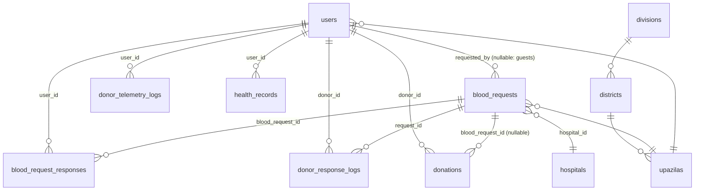

# RoktoDut data dictionary

Column lists below were generated by running all migrations on a fresh SQLite database
(2026-11-24), not written from memory. Classification and "used for" notes are our own.

## Sensitivity classes

| Class | Meaning | Rule |
|---|---|---|
| **public** | Safe to show anyone | No restriction |
| **internal** | Operational data, not personal | Fine in analytics |
| **PII** | Identifies or can contact a person | Never leaves the app database. Dropped or hashed before analytics |
| **health** | Health-related (blood group, donation history, vitals) | Aggregate only, never as an ML feature without review |
| **secret** | Credentials, tokens, ID documents | Never copied anywhere. Encrypt at rest |

## How the main tables relate

## `users` (73 columns)

| Columns | Class | Notes |
|---|---|---|
| `id`, `role`, `is_donor`, `is_available`, `is_ready_now`, `is_onboarded`, `is_shadowbanned`, `priority_tier`, `created_at`, `updated_at`, `last_login_at` | internal | `is_donor` + `is_available` decide whether someone can be notified |
| `name`, `email`, `edu_email`, `phone`, `address`, `date_of_birth`, `profile_image`, `referral_code`, `referred_by` | **PII** | Dropped before analytics |
| `latitude`, `longitude` | **PII** (precise location) | Analytics may only use `upazila_id` |
| `division_id`, `district_id`, `upazila_id` | internal | Safe geographic level for analytics |
| `blood_group`, `gender`, `weight` | **health** | Gender and weight feed eligibility rules. Blood group is used in aggregates |
| `last_donated_at`, `last_donation_date`, `last_whole_blood_donated_at`, `last_plasma_donated_at`, `last_platelet_donated_at`, `cooldown_until`, `total_donations`, `total_verified_donations`, `reminder_stage` | **health** | Donation history. Eligibility is computed from these (see `config/eligibility.php`) |
| `dfi_score` | internal | Donor Fatigue Index, a hand-built heuristic (not ML) |
| `points`, `reward_points`, `monthly_points`, `monthly_points_month`, `verified_badge`, `is_campus_hero` | internal | Gamification |
| `nid_number`, `nid_number_hash`, `nid_image`, `nid_path`, `nid_status`, `nid_uploaded_at`, `nid_retention_until`, `nid_last_accessed_at`, `medical_clearance_document` | **secret** | National ID and medical documents. Must never reach analytics. `nid_number` is currently plaintext (known risk) |
| `password`, `remember_token`, `provider`, `provider_id`, `qr_token`, `fcm_token`, `telegram_chat_id`, `telegram_verify_token`, `telegram_connected_at` | **secret** | Credentials and push or chat identifiers |
| `organization_id`, `opt_out_org_broadcast`, `hide_phone`, `spam_strikes`, `suspension_reason`, `rejected_reason`, `reviewed_by`, `reviewed_at`, `super_critical_tokens`, `welcome_back_checked`, `email_verified_at` | internal | Governance and preferences |

## `blood_requests` (33 columns): demand

| Column | Class | Notes |
|---|---|---|
| `id`, `status`, `urgency`, `component_type`, `is_super_critical`, `priority_score`, `created_at`, `updated_at`, `needed_at` | internal | `status`: pending, in_progress, fulfilled, expired, (more values exist, see `UrgencyLevel` and controllers) |
| `blood_group`, `bags_needed`, `units_needed` | internal | **Both unit columns exist and mean the same thing.** Known debt |
| `division_id`, `district_id`, `upazila_id`, `hospital_id` | internal | Safe geography |
| `latitude`, `longitude`, `address`, `location_text` | PII-ish | Often a hospital, but can be a home address |
| `patient_name`, `contact_name`, `contact_number`, `contact_number_normalized`, `notes` | **PII / health** | Patient identity and phone. Dropped before analytics |
| `requested_by` | PII link | Nullable (guest requests) |
| `guest_token`, `created_ip_hash` | secret | Abuse tracking |
| `is_phone_hidden`, `is_hidden`, `spam_report_count`, `managed_report_count` | internal | Moderation signals |
| `ml_confidence_score` | internal | Set when a request was created by the NLP parser |

## `blood_request_responses` (14 columns): what donors actually said

| Column | Class | Notes |
|---|---|---|
| `status` | internal | **Donor side:** `pending` = "I can donate", `contacted` = donor pinged a hidden-phone request, `declined`, `withdrawn`. **Requester side:** `accepted`, `rejected`. Not backed by an enum yet |
| `blood_request_id`, `user_id`, `created_at`, `updated_at`, `donor_claimed_at`, `fulfilled_at`, `fulfilled_by`, `pinged_at`, `is_ping_sent`, `verification_status` | internal | |
| `verification_pin`, `proof_image_path` | secret | Donation verification |

## `donor_response_logs` (14 columns): the ML training table

One row per (request, donor) the system **notified**. Rows are created by the dispatch jobs and
finished by `DonorResponseLogger`.

| Column | Meaning |
|---|---|
| `request_id`, `donor_id` | Who was notified about what |
| `notified_at` | When the notification went out |
| `status` | `pending` (not answered yet), `accepted` (donor said yes), `declined`, `ignored` (no answer: request closed, or 24 h passed) |
| `responded_at`, `response_time_minutes` | First answer only. A later change of mind updates `status` but not these |
| `distance_km`, `days_since_last_donation`, `temporal_hour`, `is_weekend` | Features **as they were at notification time**. `distance_km` is NULL when unknown; `days_since_last_donation` is 365 for a donor who never donated |
| `historical_response_rate` | Donor's smoothed rate at notification time (`ResponseRateService`) |

Class: internal, but the donor link makes it personal data. Pseudonymise `donor_id` for analytics.

## `donor_telemetry_logs` (9 columns)

`user_id`, `blood_request_id`, `notification_type`, `latency_ms`, `ignored` (default true until the donor reacts), `distance_km`.
Written when a notification is sent and updated when the donor responds. Overlaps with
`donor_response_logs`, so we use the latter for ML and keep this one for delivery latency.

## `donations` (15 columns): supply

| Column | Class | Notes |
|---|---|---|
| `donor_id`, `blood_request_id`, `donation_date`, `claim_status`, `journey_status`, `claim_deadline`, `points_earned` | health | |
| `district` | internal | **Free-text string**, unlike the `district_id` foreign keys everywhere else. Joins on it will mismatch |
| `hospital`, `notes` | internal / PII-ish | Free text |
| `certificate_token`, `certificate_generated_at` | secret | Public verification link |

## `health_records` (10 columns)

`user_id`, `systolic_bp`, `diastolic_bp`, `hemoglobin_level`, `weight_kg`, `recorded_at`, `source`.
Class: **health**. Every row is `source = self_reported` (unverified). Not used for ranking and
not to be exported to analytics.

## `hospitals` (9 columns) and `blood_inventories` (8 columns)

`hospitals`: `name`, `name_bn`, `aliases`, `district_id`, `upazila_id`, `is_verified`. Public. **No coordinates.**
`blood_inventories`: `organization_id`, `blood_group`, `units_available`, `is_accepting_donations`. Public/internal.

## Known data-quality issues

1. `bags_needed` and `units_needed` duplicate each other.
2. `last_donated_at` and `last_donation_date` both exist, plus three per-component columns. Eligibility now takes the most recent whole-blood date of the two.
3. `donations.district` is free text; other tables use ids.
4. `blood_request_responses.status` has no enum and mixes donor-side and requester-side values.
5. ~~`historical_response_rate` divided by all rows including `pending`, and new donors started at 0.~~ Fixed in Feature 1: `ResponseRateService` ignores `pending` and smooths toward a prior (`config/matching.php`). Rows logged before that fix still hold the old values.
5a. `distance_km` is now nullable; NULL means the request had no coordinates. Older rows with 9999 were converted to NULL by migration.
6. `donor_response_logs.donor_id` uses `cascadeOnDelete`: deleting a user deletes their training rows.
7. Log rows are created by `DispatchEmergencyAlertsJob` and `CheckAndCascadeRequestJob`. The smart-broadcast and SOS jobs both hand off to `DispatchEmergencyAlertsJob`, so every dispatch path is covered (verified by reading the dispatch chain).
8. `nid_number` is stored in plaintext.
9. `health_records` is entirely self-reported.
